# 3. Data model

**47 tables and 1 view** in PostgreSQL for the first release, plus 5 tables for marks later.
Think of each table as one register in the school office. One row is one line in that register.

This page is made by `tools/make_data_model.py` from the real database, so the columns below are always the same as the Flyway files.
Do not edit the column tables by hand: change the SQL, then run `tools/make-docs.sh`.

## Rules for every table

- `id bigint generated always as identity primary key`. In Java: `@GeneratedValue(strategy = GenerationType.IDENTITY)`.
- `created_at timestamptz not null default now()` and `updated_at timestamptz not null default now()`. In Java: `@CreationTimestamp` and `@UpdateTimestamp`.
- Two tables use a name as the key instead of an id, because they are looked up by name: `app_setting (key)` and `number_counter (counter_key)`.
- A phone is `varchar(13)`: `+91` and 10 digits. Example: `+919400000871`. The database refuses any other shape.
- Money is `numeric(12,2)`. In Java: `BigDecimal`. Never `double`.
- A **month** is a `date` on the 1st of the month: `2026-10-01` means October 2026. In Java the entity has `LocalDate`; the API shows `"2026-10"` (`YearMonth`).
- A fixed list is a `varchar` with a `check (... in (...))`. The allowed values are in the "Values" column below. In Java: an `enum` with `@Enumerated(EnumType.STRING)`.
- Every foreign key has an index, except the "who did it" columns (`created_by`, `updated_by`, `taken_by`, ...). Users are never deleted and we never search by those columns.
- People, vehicles, routes, stops and students are never deleted. They get `active = false` or a status.
- Money rows are never changed or deleted: a database trigger stops any `update` or `delete` on `fee_payment` and `family_credit_entry`. A mistake is fixed with a new row.

## Rules that live in the database, not only in Java

If the Java code has a bug, these still hold. Each one is tested in `db-checks/checks.sql`.

| Rule | How the database keeps it |
|---|---|
| One tap per child, per day, per event | `unique (student_id, service_date, event_type)` on `boarding_event` |
| "Went home with a parent" only in the evening | `check` on `boarding_event` |
| A child is on one bus (or no bus) on any day | exclusion constraint: two periods of `transport_enrolment` never share a day |
| The stop belongs to the route | two-column foreign key `(stop_id, route_id)` → `route_stop (id, route_id)` |
| One normal driver per vehicle on any day | exclusion constraint on `vehicle_assignment` |
| One vehicle runs one active route | partial unique index on `route (vehicle_id)` |
| One primary parent per child | partial unique index on `student_guardian` |
| One fee row per child per month | `unique (student_id, month)` on `fee_due` |
| Payment lines are never changed | trigger on `fee_payment` |
| The same payment click saved once | `unique (client_request_id)` on `receipt` |
| A changed late fee has a reason | `check` on `receipt` |
| One bus SMS per event per phone | partial unique index on `message_outbox` |
| One issued TC per child | partial unique index on `transfer_certificate` |
| Two sessions never share a day | exclusion constraint on `academic_session` |

The exclusion constraints need the `btree_gist` extension. V1 creates it (`create extension if not exists btree_gist`). It is a "trusted" extension, so the app's own database user can create it.

## Map of the tables

| Flyway file | Phase | Tables |
|---|---|---|
| `V1__auth_users.sql` | 1 | `app_user`, `audit_log`, `app_setting`, `academic_session` |
| `V11__user_session.sql` | cross-cutting | `user_session` |
| `V10__otp_whitelist.sql` | 1 | `otp_whitelist` |
| `V9__staff_employee.sql` | 10 | `teacher_profile`, `staff_salary` |
| `V2__vehicles_staff_routes.sql` | 2 | `vehicle`, `vehicle_document`, `staff`, `vehicle_assignment`, `route`, `route_stop` |
| `V3__students.sql` | 3 | `student`, `guardian`, `student_guardian`, `transport_enrolment`, `number_counter` |
| `V3__students.sql` | 3 | `upload`, `student_document`, `student_document_note`, `admission_draft`, `transfer_certificate` |
| `V4__trips.sql` | 4 | `boarding_event`, `holiday` |
| `V5__messaging.sql` | 5 | `bus_sms_rule`, `message_template`, `message_outbox` |
| `V14__notifications.sql` | 11 | `notification`, `message_template_button`, `message_stop`, `inbound_message` |
| `V15__notification_rules.sql` | 12 | `notification_rule`, `notification_rule_run` |
| `V6__enquiries.sql` | 6 | `enquiry`, `enquiry_stage`, `enquiry_follow_up` |
| `V7__fees.sql` | 7 | `session_fee_setting`, `class_fee`, `fee_plan`, `fee_due`, `receipt`, `fee_payment`, `family_credit_entry` |
| `V8__new_school_year.sql` | 7 | `promotion_run`, `promotion_choice` |
| `later/marks.sql` | later | `exam`, `subject`, `class_subject`, `student_mark`, `teacher_note` |
| `V7__fees.sql` | 7 | view `v_fee_month` |

## How the tables connect, in words

- A **vehicle** has 4 papers (`vehicle_document`) and people over time (`vehicle_assignment` → `staff`).
- A **route** is run by one vehicle and has ordered stops (`route_stop`).
- A **student** has parents (`student_guardian` → `guardian`). The parent marked **primary** is the **family**: brothers and sisters with the same primary parent pay together.
- A student's bus over time is `transport_enrolment`: one row per period, "on Route 4 at Jakhal from 1 April", "no bus from 1 November".
- An attendant's tap is a `boarding_event`. A tap can make rows in `message_outbox`, one per parent phone with SMS on.
- Fees: `fee_plan` (what the child pays a month) → `fee_due` (one row per month) ← `fee_payment` (lines of a `receipt`).
- An **app_user** is a login. An attendant login points at a `staff` row. Their route today comes from today's `vehicle_assignment`.

## All tables in one picture

An arrow goes from a table to the tables that point at it. Example: `route --> route_stop` means a stop belongs to a route.
The "who did it" links to `app_user` and the links to `academic_session` are left out, so the picture stays readable.

```mermaid
flowchart LR
    subgraph logins["Logins, history and school settings"]
        app_user[app_user]
        audit_log[audit_log]
        app_setting[app_setting]
        academic_session[academic_session]
    end
    subgraph sessions["Login sessions"]
        user_session[user_session]
    end
    subgraph whitelist["Test logins with a fixed code"]
        otp_whitelist[otp_whitelist]
    end
    subgraph employees["Employees and teachers"]
        teacher_profile[teacher_profile]
        staff_salary[staff_salary]
    end
    subgraph transport["Vehicles, staff and routes"]
        vehicle[vehicle]
        vehicle_document[vehicle_document]
        staff[staff]
        vehicle_assignment[vehicle_assignment]
        route[route]
        route_stop[route_stop]
    end
    subgraph students["Students, families and the bus"]
        student[student]
        guardian[guardian]
        student_guardian[student_guardian]
        transport_enrolment[transport_enrolment]
        number_counter[number_counter]
    end
    subgraph documents["Documents, admission drafts and transfer certificates"]
        upload[upload]
        student_document[student_document]
        student_document_note[student_document_note]
        admission_draft[admission_draft]
        transfer_certificate[transfer_certificate]
    end
    subgraph trips["Bus taps and holidays"]
        boarding_event[boarding_event]
        holiday[holiday]
    end
    subgraph messages["Messages to parents"]
        bus_sms_rule[bus_sms_rule]
        message_template[message_template]
        message_outbox[message_outbox]
    end
    subgraph notifications["Notifications to parents and staff"]
        notification[notification]
        message_template_button[message_template_button]
        message_stop[message_stop]
        inbound_message[inbound_message]
    end
    subgraph rules["Automatic messages (rules)"]
        notification_rule[notification_rule]
        notification_rule_run[notification_rule_run]
    end
    subgraph enquiries["Enquiries"]
        enquiry[enquiry]
        enquiry_stage[enquiry_stage]
        enquiry_follow_up[enquiry_follow_up]
    end
    subgraph fees["Fees, month by month"]
        session_fee_setting[session_fee_setting]
        class_fee[class_fee]
        fee_plan[fee_plan]
        fee_due[fee_due]
        receipt[receipt]
        fee_payment[fee_payment]
        family_credit_entry[family_credit_entry]
    end
    subgraph newyear["New school year"]
        promotion_run[promotion_run]
        promotion_choice[promotion_choice]
    end
    vehicle --> vehicle_document
    staff --> vehicle_assignment
    vehicle --> vehicle_assignment
    vehicle --> route
    route --> route_stop
    staff --> app_user
    student --> student_guardian
    guardian --> student_guardian
    student --> transport_enrolment
    route --> transport_enrolment
    route_stop --> transport_enrolment
    app_user --> user_session
    student --> student_document
    student --> student_document_note
    student --> transfer_certificate
    student --> boarding_event
    route --> boarding_event
    guardian --> receipt
    guardian --> message_outbox
    student --> message_outbox
    guardian --> enquiry
    student --> enquiry
    enquiry --> enquiry_stage
    enquiry --> enquiry_follow_up
    guardian --> family_credit_entry
    student --> family_credit_entry
    receipt --> family_credit_entry
    student --> fee_plan
    student --> fee_due
    receipt --> message_outbox
    staff --> inbound_message
    enquiry --> inbound_message
    receipt --> fee_payment
    student --> fee_payment
    promotion_run --> promotion_choice
    student --> promotion_choice
    staff --> staff_salary
    staff --> teacher_profile
    message_outbox --> inbound_message
    app_user --> inbound_message
    message_template --> message_template_button
    message_template --> notification
    notification --> message_outbox
    staff --> message_outbox
    enquiry --> message_outbox
    guardian --> inbound_message
    guardian --> message_stop
    notification --> message_stop
    message_template --> notification_rule
    notification_rule --> notification_rule_run
    notification --> notification_rule_run
    notification_rule --> notification
```

Also as a picture: `docs/diagrams/overview.svg`.


---

## Logins, history and school settings

Flyway file: `V1__auth_users.sql` · Phase 1

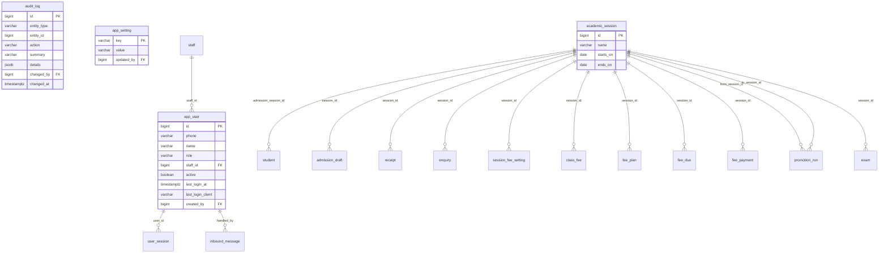

### `app_user`

A person who can log in. The login id is the phone number; there is no password.

| Column | Type | Can be empty | Values or limits | Note |
|---|---|---|---|---|
| `id` | bigint |  |  | identity |
| `phone` | varchar(13) |  |  |  |
| `name` | varchar(120) | yes |  |  |
| `role` | varchar(30) |  | `OWNER`, `OFFICE_ADMIN`, `TRANSPORT_INCHARGE`, `ADMISSIONS_DESK`, `ATTENDANT` |  |
| `staff_id` | bigint | yes |  | → `staff`. foreign key added in V2 |
| `active` | boolean |  | default `true` |  |
| `last_login_at` | timestamptz | yes |  |  |
| `last_login_client` | varchar(20) | yes | `WEB`, `ATTENDANT_APP` |  |
| `created_by` | bigint | yes |  | → `app_user` |

Plus `created_at` and `updated_at`.

**Rules**

- An attendant login must point at a `staff` row, and one staff person has at most one login.
- Logout, phone change, role change and turning a user off end their sessions (`user_session`), not a version number on this row.
- A user is never deleted. `active = false` turns the login off; their name stays on old taps and receipts.

<details><summary>Constraints and indexes in the database</summary>

- `app_user_phone_check`: `CHECK (((phone)::text ~ '^\+91[6-9][0-9]{9}$'::text))`
- `app_user_attendant_has_staff`: `CHECK ((((role)::text <> 'ATTENDANT'::text) OR (staff_id IS NOT NULL)))`
- `app_user_phone_key`: `UNIQUE (phone)`
- `app_user_one_per_staff`: `CREATE UNIQUE INDEX app_user_one_per_staff ON app_user (staff_id) WHERE (staff_id IS NOT NULL)`

</details>

**Example rows** (from the sample data)

- `id` 1 · `phone` +919800000501 · `name` Sourabh · `role` OWNER · `active` true · `last_login_at` 2026-10-07 03:25 · `last_login_client` WEB
- `id` 14 · `phone` +919700000204 · `name` Balwan · `role` ATTENDANT · `staff_id` 24 · `active` true · `last_login_at` 2026-10-07 01:28 · `last_login_client` ATTENDANT_APP · `created_by` 1

**Used by:** `/auth/*`, `/users/*`, `every table's created_by`

### `audit_log`

Who changed what, in one human line. Feeds "Change history". Also records every time a private document is opened.

| Column | Type | Can be empty | Values or limits | Note |
|---|---|---|---|---|
| `id` | bigint |  |  | identity |
| `entity_type` | varchar(40) |  |  | STUDENT, VEHICLE, USER, ROUTE, RECEIPT, DOCUMENT, FEE_SETTING, ... |
| `entity_id` | bigint |  |  |  |
| `action` | varchar(20) |  | `CREATED`, `UPDATED`, `DELETED`, `LOGIN`, `OPENED`, `CANCELLED` |  |
| `summary` | varchar(300) |  |  | one line for people: 'Section changed from B to A' |
| `details` | jsonb | yes |  | old and new values |
| `changed_by` | bigint | yes |  | → `app_user` |
| `changed_at` | timestamptz |  | default `now()` |  |

Plus `created_at` and `updated_at`.

<details><summary>Constraints and indexes in the database</summary>

- `audit_log_entity_idx`: `CREATE INDEX audit_log_entity_idx ON audit_log (entity_type, entity_id, changed_at DESC)`

</details>

**Example rows** (from the sample data)

- `id` 1 · `entity_type` STUDENT · `entity_id` 118 · `action` CREATED · `summary` Admitted to Class 4, no bus · `changed_by` 4 · `changed_at` 2026-04-01 04:50
- `id` 2 · `entity_type` STUDENT · `entity_id` 118 · `action` UPDATED · `summary` Mother's phone number added · `changed_by` 4 · `changed_at` 2026-06-03 06:10
- `id` 3 · `entity_type` STUDENT · `entity_id` 118 · `action` UPDATED · `summary` Section changed from B to A · `changed_by` 2 · `changed_at` 2026-08-12 04:35

**Used by:** `GET /students/{id}/history`, `every write of students`, `vehicles`, `users`, `fees`

### `app_setting`

School-wide values, one row per key (school name, office phone, transport numbers).

| Column | Type | Can be empty | Values or limits | Note |
|---|---|---|---|---|
| `key` | varchar(60) |  |  |  |
| `value` | varchar(300) |  |  |  |
| `updated_by` | bigint | yes |  | → `app_user` |

Plus `created_at` and `updated_at`.

**Example rows** (from the sample data)

- `key` transport.collection_pct · `value` 95
- `key` transport.late_after_minutes · `value` 10
- `key` transport.months_operated · `value` 11

**Used by:** `/settings/school`, `/settings/transport`, `GET /routes/load-board`

### `academic_session`

One school year, 1 April to 31 March. "Current" is not stored; it is the session whose dates include today.

| Column | Type | Can be empty | Values or limits | Note |
|---|---|---|---|---|
| `id` | bigint |  |  | identity |
| `name` | varchar(7) |  |  | '2026-27' |
| `starts_on` | date |  |  |  |
| `ends_on` | date |  |  |  |

Plus `created_at` and `updated_at`.

**Rules**

- Two sessions can never share a day (exclusion constraint).
- Moved from V7 to V1, because admissions and enquiries need it before fees.

<details><summary>Constraints and indexes in the database</summary>

- `academic_session_name_check`: `CHECK (((name)::text ~ '^[0-9]{4}-[0-9]{2}$'::text))`
- `academic_session_dates`: `CHECK ((ends_on > starts_on))`
- `academic_session_name_key`: `UNIQUE (name)`
- `academic_session_no_overlap`: `EXCLUDE USING gist (daterange(starts_on, ends_on, '[]'::text) WITH &&)`

</details>

**Example rows** (from the sample data)

- `id` 3 · `name` 2026-27 · `starts_on` 2026-04-01 · `ends_on` 2027-03-31
- `id` 4 · `name` 2027-28 · `starts_on` 2027-04-01 · `ends_on` 2028-03-31

**Used by:** `GET /sessions`, `POST /sessions`, `every fee table`


---

## Login sessions

Flyway file: `V11__user_session.sql` · Phase cross-cutting

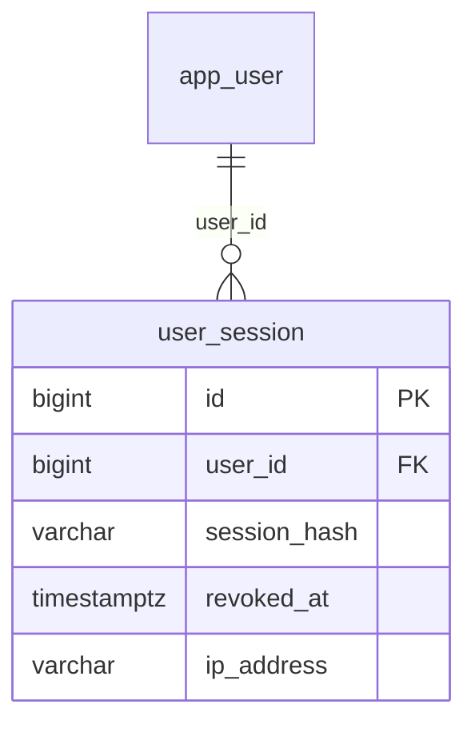

### `user_session`

One login session, made when an OTP is checked and right. Only its HMAC is kept, never the raw session id.

| Column | Type | Can be empty | Values or limits | Note |
|---|---|---|---|---|
| `id` | bigint |  |  | identity |
| `user_id` | bigint |  |  | → `app_user` |
| `session_hash` | varchar(64) |  |  | HMAC-SHA256 of the raw session id. Never store it plain. |
| `revoked_at` | timestamptz | yes |  |  |
| `ip_address` | varchar(45) | yes |  |  |

Plus `created_at` and `updated_at`.

**Rules**

- The hot path is Redis (`session:<id>`), not this table. This row is the fallback for when Redis has forgotten a session, and the only place "log out everywhere" can find every session of one user.
- There is no expires_at column. The 15-minute idle timeout lives only in Redis, where it slides forward on every request. This table only knows "revoked?" and "older than the 12-hour hard cap?" (worked out from created_at).
- Logout revokes only this one row. Turn off, role change and phone change revoke every row of that user_id at once.

<details><summary>Constraints and indexes in the database</summary>

- `user_session_hash_idx`: `CREATE UNIQUE INDEX user_session_hash_idx ON user_session (session_hash)`
- `user_session_user_idx`: `CREATE INDEX user_session_user_idx ON user_session (user_id, revoked_at)`

</details>

**Used by:** `POST /auth/otp/verify`, `every other request's Authorization header`, `POST /auth/logout`


---

## Test logins with a fixed code

Flyway file: `V10__otp_whitelist.sql` · Phase 1

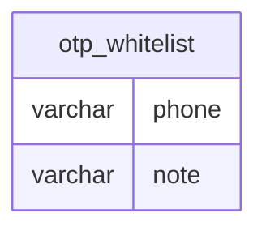

### `otp_whitelist`

Test and demo phones that log in with a fixed code (123456, or 1234 with 4-digit codes), with no real WhatsApp or SMS sent (decision B25).

| Column | Type | Can be empty | Values or limits | Note |
|---|---|---|---|---|
| `phone` | varchar(13) |  |  |  |
| `note` | varchar(120) | yes |  |  |

Plus `created_at` and `updated_at`.

**Rules**

- Rows are added by hand or by the local dev data; there is no API for them.
- The phone has the usual +91 shape.

<details><summary>Constraints and indexes in the database</summary>

- `otp_whitelist_phone_ck`: `CHECK (((phone)::text ~ '^\+91[6-9][0-9]{9}$'::text))`

</details>

**Used by:** `POST /auth/otp/request`, `POST /auth/otp/verify`


---

## Employees and teachers

Flyway file: `V9__staff_employee.sql` · Phase 10

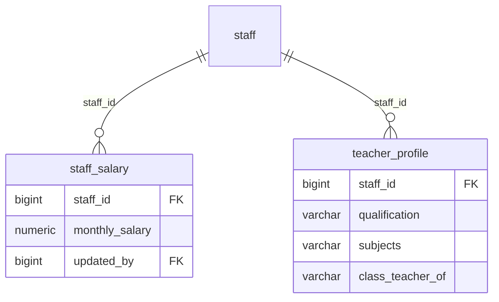

### `teacher_profile`

The teaching extras of a staff row whose type is TEACHER (decision B23); other employees have none.

| Column | Type | Can be empty | Values or limits | Note |
|---|---|---|---|---|
| `staff_id` | bigint |  |  | → `staff` |
| `qualification` | varchar(120) | yes |  |  |
| `subjects` | varchar(200) | yes |  |  |
| `class_teacher_of` | varchar(20) | yes |  |  |

Plus `created_at` and `updated_at`.

**Rules**

- The staff id is the primary key, so one teacher has at most one profile.
- One class has at most one class teacher (partial unique index on class_teacher_of).

<details><summary>Constraints and indexes in the database</summary>

- `teacher_profile_class_uk`: `CREATE UNIQUE INDEX teacher_profile_class_uk ON teacher_profile (class_teacher_of) WHERE (class_teacher_of IS NOT NULL)`

</details>

**Used by:** `GET /staff/{id}`, `PUT /staff/{id}`

### `staff_salary`

The monthly salary of an employee, in its own table with its own permission STAFF_SALARY_VIEW (decision B24), so the staff list never shows it.

| Column | Type | Can be empty | Values or limits | Note |
|---|---|---|---|---|
| `staff_id` | bigint |  |  | → `staff` |
| `monthly_salary` | numeric(12,2) |  | `>= 0` |  |
| `updated_by` | bigint | yes |  | → `app_user` |

Plus `created_at` and `updated_at`.

**Rules**

- One row per employee (staff id is the primary key). Never below 0.
- Only the owner sees or changes it.

<details><summary>Constraints and indexes in the database</summary>

- `staff_salary_updated_by_ix`: `CREATE INDEX staff_salary_updated_by_ix ON staff_salary (updated_by)`

</details>

**Used by:** `GET /staff/{id}/salary`, `PUT /staff/{id}/salary`


---

## Vehicles, staff and routes

Flyway file: `V2__vehicles_staff_routes.sql` · Phase 2

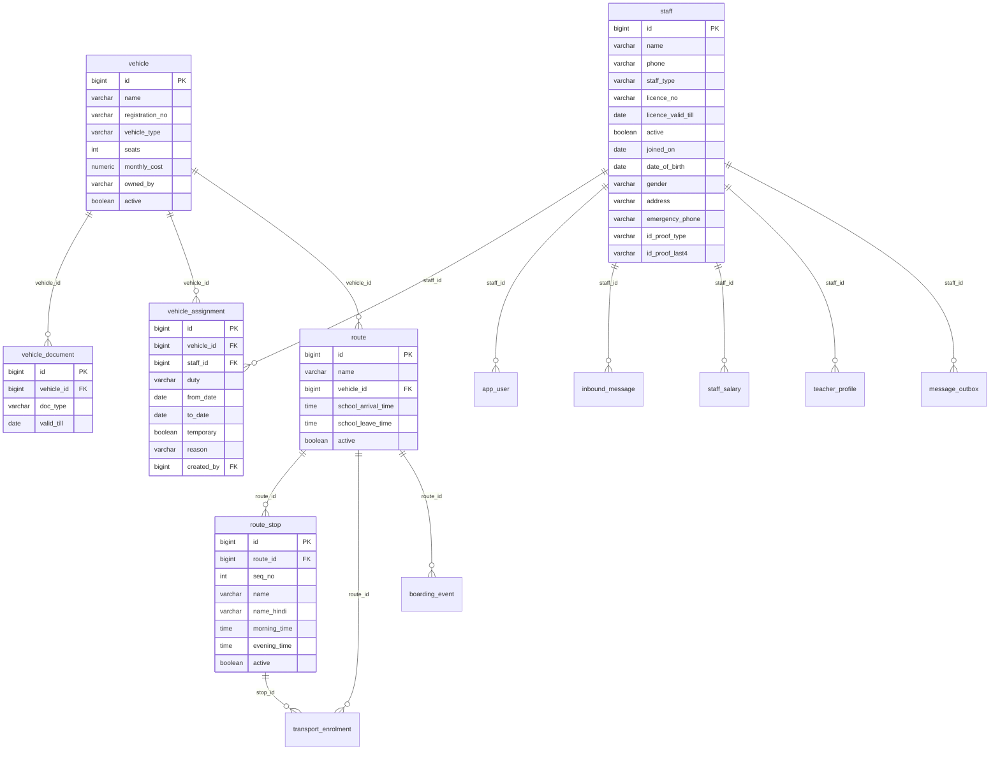

### `vehicle`

A van or bus.

| Column | Type | Can be empty | Values or limits | Note |
|---|---|---|---|---|
| `id` | bigint |  |  | identity |
| `name` | varchar(40) |  |  | 'Van 4' |
| `registration_no` | varchar(20) |  |  | 'HR 23 AB 1104' |
| `vehicle_type` | varchar(20) |  | `SMALL_VAN`, `MID_BUS`, `BIG_BUS` |  |
| `seats` | int |  | `> 0` |  |
| `monthly_cost` | numeric(12,2) |  | `>= 0` · default `0` | all-in: 30300.00 |
| `owned_by` | varchar(20) |  | `SCHOOL`, `CONTRACTOR` · default `SCHOOL` |  |
| `active` | boolean |  | default `true` |  |

Plus `created_at` and `updated_at`.

**Rules**

- Never deleted. `active = false` when it is removed.

<details><summary>Constraints and indexes in the database</summary>

- `vehicle_name_key`: `UNIQUE (name)`
- `vehicle_registration_no_key`: `UNIQUE (registration_no)`

</details>

**Example rows** (from the sample data)

- `id` 4 · `name` Van 4 · `registration_no` HR 23 AB 1104 · `vehicle_type` SMALL_VAN · `seats` 14 · `monthly_cost` 30300.00 · `owned_by` CONTRACTOR · `active` true
- `id` 9 · `name` Bus 9 · `registration_no` HR 23 AB 2109 · `vehicle_type` MID_BUS · `seats` 26 · `monthly_cost` 30300.00 · `owned_by` CONTRACTOR · `active` true

**Used by:** `/vehicles/*`, `GET /routes/load-board`, `GET /bus-status`

### `vehicle_document`

One paper of one vehicle (fitness, insurance, permit, pollution). 4 rows per vehicle.

| Column | Type | Can be empty | Values or limits | Note |
|---|---|---|---|---|
| `id` | bigint |  |  | identity |
| `vehicle_id` | bigint |  |  | → `vehicle` |
| `doc_type` | varchar(20) |  | `FITNESS`, `INSURANCE`, `PERMIT`, `PUC` |  |
| `valid_till` | date | yes |  | the last valid day |

Plus `created_at` and `updated_at`.

**Rules**

- Status is counted, not stored: empty = MISSING, before today = ENDED, 30 days or less = ENDING_SOON, else VALID.

<details><summary>Constraints and indexes in the database</summary>

- `vehicle_document_one_per_type`: `UNIQUE (vehicle_id, doc_type)`

</details>

**Example rows** (from the sample data)

- `id` 13 · `vehicle_id` 4 · `doc_type` FITNESS · `valid_till` 2027-03-31
- `id` 14 · `vehicle_id` 4 · `doc_type` INSURANCE · `valid_till` 2027-02-14
- `id` 15 · `vehicle_id` 4 · `doc_type` PERMIT · `valid_till` 2028-03-31
- `id` 16 · `vehicle_id` 4 · `doc_type` PUC · `valid_till` 2026-12-20

**Used by:** `PUT /vehicles/{id}/documents`, `GET /vehicles/attention`

### `staff`

A driver, attendant or helper.

| Column | Type | Can be empty | Values or limits | Note |
|---|---|---|---|---|
| `id` | bigint |  |  | identity |
| `name` | varchar(120) |  |  |  |
| `phone` | varchar(13) |  |  |  |
| `staff_type` | varchar(20) |  | `DRIVER`, `ATTENDANT`, `HELPER`, `TEACHER` |  |
| `licence_no` | varchar(30) | yes |  |  |
| `licence_valid_till` | date | yes |  |  |
| `active` | boolean |  | default `true` |  |
| `joined_on` | date | yes |  |  |
| `date_of_birth` | date | yes |  |  |
| `gender` | varchar(10) | yes |  |  |
| `address` | varchar(300) | yes |  |  |
| `emergency_phone` | varchar(13) | yes |  |  |
| `id_proof_type` | varchar(20) | yes |  |  |
| `id_proof_last4` | varchar(4) | yes |  |  |

Plus `created_at` and `updated_at`.

**Rules**

- A driver must have a licence number and date.

<details><summary>Constraints and indexes in the database</summary>

- `staff_phone_check`: `CHECK (((phone)::text ~ '^\+91[6-9][0-9]{9}$'::text))`
- `staff_driver_has_licence`: `CHECK ((((staff_type)::text <> 'DRIVER'::text) OR ((licence_no IS NOT NULL) AND (licence_valid_till IS NOT NULL))))`
- `staff_gender_ck`: `CHECK (((gender IS NULL) OR ((gender)::text = ANY ((ARRAY['MALE'::character varying, 'FEMALE'::character varying, 'OTHER'::character varying])::text[]))))`
- `staff_emergency_phone_ck`: `CHECK (((emergency_phone IS NULL) OR ((emergency_phone)::text ~ '^\+91[6-9][0-9]{9}$'::text)))`
- `staff_id_proof_type_ck`: `CHECK (((id_proof_type IS NULL) OR ((id_proof_type)::text = ANY ((ARRAY['AADHAAR'::character varying, 'VOTER_ID'::character varying, 'PAN'::character varying, 'DRIVING_LICENCE'::character varying])::text[]))))`
- `staff_id_proof_last4_ck`: `CHECK (((id_proof_last4 IS NULL) OR ((id_proof_last4)::text ~ '^[0-9]{4}$'::text)))`
- `staff_id_proof_ck`: `CHECK (((id_proof_type IS NULL) = (id_proof_last4 IS NULL)))`

</details>

**Example rows** (from the sample data)

- `id` 14 · `name` Jagdish · `phone` +919800000104 · `staff_type` DRIVER · `licence_no` HR23 20110000087 · `licence_valid_till` 2028-07-08 · `active` true
- `id` 20 · `name` Surender · `phone` +919700000110 · `staff_type` DRIVER · `licence_no` HR23 20180002265 · `licence_valid_till` 2030-01-21 · `active` true
- `id` 24 · `name` Balwan · `phone` +919700000204 · `staff_type` ATTENDANT · `active` true

**Used by:** `/staff/*`, `POST /users (attendant login)`

### `vehicle_assignment`

Who works on which vehicle, from which day to which day.

| Column | Type | Can be empty | Values or limits | Note |
|---|---|---|---|---|
| `id` | bigint |  |  | identity |
| `vehicle_id` | bigint |  |  | → `vehicle` |
| `staff_id` | bigint |  |  | → `staff` |
| `duty` | varchar(20) |  | `DRIVER`, `ATTENDANT`, `HELPER` |  |
| `from_date` | date |  |  |  |
| `to_date` | date | yes |  |  |
| `temporary` | boolean |  | default `false` |  |
| `reason` | varchar(20) | yes | `ON_LEAVE`, `LEFT_SCHOOL`, `MOVED`, `OTHER` |  |
| `created_by` | bigint |  |  | → `app_user` |

Plus `created_at` and `updated_at`.

**Rules**

- A normal row has no `to_date` while it goes on. A temporary row (a replacement for some days) needs a `to_date`.
- On a day, the temporary row wins over the normal row.
- One normal person per vehicle and duty on any day, and one temporary person (two exclusion constraints).
- "One person on one vehicle per day" is checked in the service, because a temporary move is allowed after the user says yes.

<details><summary>Constraints and indexes in the database</summary>

- `vehicle_assignment_dates`: `CHECK (((to_date IS NULL) OR (to_date >= from_date)))`
- `vehicle_assignment_temporary_has_end`: `CHECK (((NOT temporary) OR (to_date IS NOT NULL)))`
- `vehicle_assignment_one_normal`: `EXCLUDE USING gist (vehicle_id WITH =, duty WITH =, daterange(from_date, to_date, '[]'::text) WITH &&) WHERE ((NOT temporary))`
- `vehicle_assignment_one_temporary`: `EXCLUDE USING gist (vehicle_id WITH =, duty WITH =, daterange(from_date, to_date, '[]'::text) WITH &&) WHERE (temporary)`
- `vehicle_assignment_vehicle_idx`: `CREATE INDEX vehicle_assignment_vehicle_idx ON vehicle_assignment (vehicle_id, from_date)`
- `vehicle_assignment_staff_idx`: `CREATE INDEX vehicle_assignment_staff_idx ON vehicle_assignment (staff_id, from_date)`

</details>

**Example rows** (from the sample data)

- `id` 4 · `vehicle_id` 4 · `staff_id` 14 · `duty` DRIVER · `from_date` 2026-04-01 · `temporary` false · `created_by` 3
- `id` 13 · `vehicle_id` 4 · `staff_id` 24 · `duty` ATTENDANT · `from_date` 2026-04-01 · `temporary` false · `created_by` 3
- `id` 19 · `vehicle_id` 4 · `staff_id` 13 · `duty` DRIVER · `from_date` 2025-07-01 · `to_date` 2026-03-31 · `temporary` false · `reason` MOVED · `created_by` 3
- `id` 20 · `vehicle_id` 4 · `staff_id` 29 · `duty` ATTENDANT · `from_date` 2025-07-01 · `to_date` 2026-03-31 · `temporary` false · `reason` LEFT_SCHOOL · `created_by` 3

**Used by:** `POST /vehicles/{id}/assignments`, `GET /vehicles/{id}/assignments`, `GET /trips/my-route`

### `route`

A route is one vehicle and its stops.

| Column | Type | Can be empty | Values or limits | Note |
|---|---|---|---|---|
| `id` | bigint |  |  | identity |
| `name` | varchar(80) |  |  | 'Route 4' |
| `vehicle_id` | bigint | yes |  | → `vehicle` |
| `school_arrival_time` | time |  | default `08:10:00` |  |
| `school_leave_time` | time |  | default `14:40:00` |  |
| `active` | boolean |  | default `true` |  |

Plus `created_at` and `updated_at`.

**Rules**

- One vehicle runs at most one active route.

<details><summary>Constraints and indexes in the database</summary>

- `route_name_key`: `UNIQUE (name)`
- `route_one_per_vehicle`: `CREATE UNIQUE INDEX route_one_per_vehicle ON route (vehicle_id) WHERE active`

</details>

**Example rows** (from the sample data)

- `id` 4 · `name` Route 4 · `vehicle_id` 4 · `school_arrival_time` 08:10:00 · `school_leave_time` 14:40:00 · `active` true
- `id` 9 · `name` Route 9 · `vehicle_id` 9 · `school_arrival_time` 08:20:00 · `school_leave_time` 14:40:00 · `active` true

**Used by:** `/routes/*`, `GET /bus-status`

### `route_stop`

A stop of a route, in the morning order. The evening goes the other way round.

| Column | Type | Can be empty | Values or limits | Note |
|---|---|---|---|---|
| `id` | bigint |  |  | identity |
| `route_id` | bigint |  |  | → `route` |
| `seq_no` | int |  | `> 0` |  |
| `name` | varchar(80) |  |  | 'Jakhal' |
| `name_hindi` | varchar(80) | yes |  | 'जाखल', for the attendant app |
| `morning_time` | time | yes |  |  |
| `evening_time` | time | yes |  |  |
| `active` | boolean |  | default `true` |  |

Plus `created_at` and `updated_at`.

**Rules**

- A removed stop is set `active = false`, because old bus rows still point at it.
- `seq_no` does not repeat among the active stops of a route. To reorder: add 1000 to all, then write the new order.

<details><summary>Constraints and indexes in the database</summary>

- `route_stop_id_route`: `UNIQUE (id, route_id)`
- `route_stop_seq`: `CREATE UNIQUE INDEX route_stop_seq ON route_stop (route_id, seq_no) WHERE active`

</details>

**Example rows** (from the sample data)

- `id` 11 · `route_id` 4 · `seq_no` 1 · `name` Sadhanwas · `name_hindi` साधनवास · `morning_time` 07:25:00 · `evening_time` 15:31:00 · `active` true
- `id` 12 · `route_id` 4 · `seq_no` 2 · `name` Jakhal · `name_hindi` जाखल · `morning_time` 07:40:00 · `evening_time` 15:22:00 · `active` true
- `id` 13 · `route_id` 4 · `seq_no` 3 · `name` Kanheri · `name_hindi` कन्हेड़ी · `morning_time` 07:55:00 · `evening_time` 15:14:00 · `active` true
- `id` 14 · `route_id` 4 · `seq_no` 4 · `name` Tohana town · `name_hindi` टोहाना शहर · `morning_time` 08:02:00 · `evening_time` 15:05:00 · `active` true

**Used by:** `PUT /routes/{id}/stops`, `GET /trips/manifest`


---

## Students, families and the bus

Flyway file: `V3__students.sql` · Phase 3

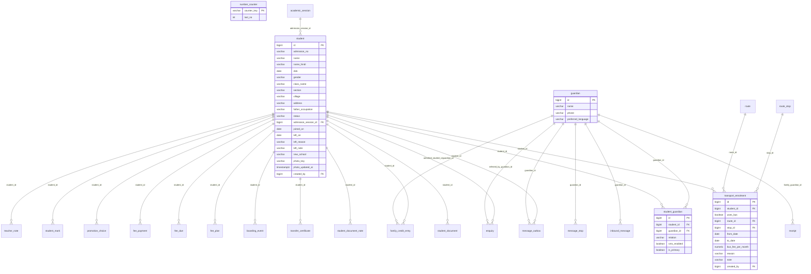

### `student`

One child.

| Column | Type | Can be empty | Values or limits | Note |
|---|---|---|---|---|
| `id` | bigint |  |  | identity |
| `admission_no` | varchar(20) |  |  | 'A-2026-118' |
| `name` | varchar(120) |  |  |  |
| `name_hindi` | varchar(120) | yes |  | 'आर्यन', for the attendant app |
| `dob` | date |  |  |  |
| `gender` | varchar(1) |  | `M`, `F` | Hindi SMS: चढ़ गया / चढ़ गई |
| `class_name` | varchar(10) |  | `Nursery`, `LKG`, `UKG`, `1`, `2`, `3`, `4`, `5`, `6`, `7`, `8`, `9`, `10`, `11`, `12` |  |
| `section` | varchar(1) | yes | `A`, `B`, `C` |  |
| `village` | varchar(80) |  |  |  |
| `address` | varchar(200) | yes |  |  |
| `father_occupation` | varchar(30) |  | `FARMER_SMALL`, `FARMER_LARGE`, `GOVT_EMPLOYEE`, `EX_SERVICEMAN`, `SHOPKEEPER`, `PRIVATE_JOB`, `LABOUR`, `TEACHER_PROFESSIONAL`, `FAMILY_ABROAD`, `OTHER` |  |
| `status` | varchar(10) |  | `ACTIVE`, `LEFT`, `FINISHED` · default `ACTIVE` |  |
| `admission_session_id` | bigint | yes |  | → `academic_session`. empty for children imported from the old register |
| `joined_on` | date |  |  |  |
| `left_on` | date | yes |  |  |
| `left_reason` | varchar(30) | yes | `MOVING_TOWN`, `OTHER_SCHOOL_HERE`, `FEES_TOO_HIGH`, `BUS_OR_DISTANCE`, `FINISHED_CLASS_12`, `OTHER` |  |
| `left_note` | varchar(300) | yes |  |  |
| `new_school` | varchar(120) | yes |  |  |
| `photo_key` | varchar(200) | yes |  | key in private storage, never a public URL |
| `photo_updated_at` | timestamptz | yes |  |  |
| `created_by` | bigint |  |  | → `app_user` |

Plus `created_at` and `updated_at`.

**Rules**

- Never deleted. `status` is ACTIVE, LEFT (left the school) or FINISHED (finished Class 12).
- A child admitted for next year has `joined_on` in the future. They are ACTIVE but not counted yet.
- `photo_key` is a key in private storage. A photo never has a public URL.

<details><summary>Constraints and indexes in the database</summary>

- `student_admission_no_check`: `CHECK (((admission_no)::text ~ '^A-[0-9]{4}-[0-9]{3,}$'::text))`
- `student_left_has_date`: `CHECK ((((status)::text = 'ACTIVE'::text) OR (left_on IS NOT NULL)))`
- `student_left_has_reason`: `CHECK ((((status)::text <> 'LEFT'::text) OR (left_reason IS NOT NULL)))`
- `student_admission_no_key`: `UNIQUE (admission_no)`
- `student_admission_session_idx`: `CREATE INDEX student_admission_session_idx ON student (admission_session_id)`
- `student_class_idx`: `CREATE INDEX student_class_idx ON student (class_name, section) WHERE ((status)::text = 'ACTIVE'::text)`
- `student_village_idx`: `CREATE INDEX student_village_idx ON student (village)`

</details>

**Example rows** (from the sample data)

- `id` 57 · `admission_no` A-2024-057 · `name` Aryan Punia · `name_hindi` आर्यन · `dob` 2018-02-10 · `gender` M · `class_name` 3 · `section` B · `village` Jakhal · `father_occupation` FARMER_LARGE · `status` ACTIVE · `joined_on` 2024-04-01 · `created_by` 4
- `id` 118 · `admission_no` A-2026-118 · `name` Ishaan Sharma · `name_hindi` ईशान · `dob` 2017-03-12 · `gender` M · `class_name` 4 · `section` A · `village` Tohana town · `address` Model Town · `father_occupation` GOVT_EMPLOYEE · `status` ACTIVE · `admission_session_id` 3 · `joined_on` 2026-04-01 · `created_by` 4

**Used by:** `/students/*`, `POST /admissions`, `/students/{id}/leave`

### `guardian`

A parent or relative, with their phone. One phone is one row, even for three children.

| Column | Type | Can be empty | Values or limits | Note |
|---|---|---|---|---|
| `id` | bigint |  |  | identity |
| `name` | varchar(120) | yes |  |  |
| `phone` | varchar(13) | yes |  |  |
| `preferred_language` | varchar(5) |  | default `hi` |  |

Plus `created_at` and `updated_at`.

**Rules**

- A parent can be saved with no phone ("Mother, no number saved"), but then they get no messages.

<details><summary>Constraints and indexes in the database</summary>

- `guardian_name_or_phone`: `CHECK (((name IS NOT NULL) OR (phone IS NOT NULL)))`
- `guardian_phone_check`: `CHECK (((phone)::text ~ '^\+91[6-9][0-9]{9}$'::text))`
- `guardian_phone_key`: `UNIQUE (phone)`

</details>

**Example rows** (from the sample data)

- `id` 210 · `name` Rajesh Punia · `phone` +919400000871 · `preferred_language` hi
- `id` 211 · `name` Sunita Punia · `phone` +919800000512 · `preferred_language` hi
- `id` 249 · `name` Sunita Bansal · `preferred_language` hi

**Used by:** `/students/{id}/guardians/*`, `GET /guardians/search`, `fees (the family)`

### `student_guardian`

This parent belongs to this child, with "send bus SMS" on or off.

| Column | Type | Can be empty | Values or limits | Note |
|---|---|---|---|---|
| `id` | bigint |  |  | identity |
| `student_id` | bigint |  |  | → `student` |
| `guardian_id` | bigint |  |  | → `guardian` |
| `relation` | varchar(20) |  | `FATHER`, `MOTHER`, `GRANDFATHER`, `GRANDMOTHER`, `UNCLE_AUNT`, `OTHER` |  |
| `sms_enabled` | boolean |  | default `true` | "Send bus SMS to this number" |
| `is_primary` | boolean |  | default `false` |  |

Plus `created_at` and `updated_at`.

**Rules**

- The PRIMARY guardian is the family. Children with the same primary guardian are one family in Collect fees (familyId = that guardian's id).
- At most one primary per child (partial unique index); the service makes sure there is exactly one.

<details><summary>Constraints and indexes in the database</summary>

- `student_guardian_once`: `UNIQUE (student_id, guardian_id)`
- `student_guardian_guardian_idx`: `CREATE INDEX student_guardian_guardian_idx ON student_guardian (guardian_id)`
- `student_guardian_one_primary`: `CREATE UNIQUE INDEX student_guardian_one_primary ON student_guardian (student_id) WHERE is_primary`

</details>

**Example rows** (from the sample data)

- `id` 1 · `student_id` 57 · `guardian_id` 210 · `relation` FATHER · `sms_enabled` true · `is_primary` true
- `id` 3 · `student_id` 12 · `guardian_id` 210 · `relation` FATHER · `sms_enabled` true · `is_primary` true

**Used by:** `/students/{id}/guardians/*`, `GET /fees/families/*`

### `transport_enrolment`

The child's bus over time, as periods that never overlap. Every change is a new row.

| Column | Type | Can be empty | Values or limits | Note |
|---|---|---|---|---|
| `id` | bigint |  |  | identity |
| `student_id` | bigint |  |  | → `student` |
| `uses_bus` | boolean |  |  |  |
| `route_id` | bigint | yes |  | → `route` |
| `stop_id` | bigint | yes |  | → `route_stop (with route_id)` |
| `from_date` | date |  |  |  |
| `to_date` | date | yes |  | empty = still going on |
| `bus_fee_per_month` | numeric(12,2) | yes | `>= 0` |  |
| `reason` | varchar(20) | yes | `ADMISSION`, `FAMILY_WILL_DROP`, `MOVING_HOUSE`, `SHORTER_DISTANCE`, `OWNER_DECISION`, `LEFT_SCHOOL`, `IMPORT`, `OTHER` |  |
| `note` | varchar(200) | yes |  |  |
| `created_by` | bigint |  |  | → `app_user` |

Plus `created_at` and `updated_at`.

**Rules**

- `uses_bus = true`: route, stop and bus fee a month are filled. `uses_bus = false`: a "no bus" period.
- The stop must be a stop of the same route (a two-column foreign key).
- Two periods of one child can never share a day (exclusion constraint).
- The id of the new row is the `changeId` of the API. Undo = delete it and give the row before it its old `to_date` back.

<details><summary>Constraints and indexes in the database</summary>

- `transport_enrolment_dates`: `CHECK (((to_date IS NULL) OR (to_date >= from_date)))`
- `transport_enrolment_bus_fields`: `CHECK (((uses_bus AND (route_id IS NOT NULL) AND (stop_id IS NOT NULL) AND (bus_fee_per_month IS NOT NULL)) OR ((NOT uses_bus) AND (route_id IS NULL) AND (stop_id IS NULL) AND (bus_fee_per_month IS NULL))))`
- `transport_enrolment_no_overlap`: `EXCLUDE USING gist (student_id WITH =, daterange(from_date, to_date, '[]'::text) WITH &&)`
- `transport_enrolment_student_idx`: `CREATE INDEX transport_enrolment_student_idx ON transport_enrolment (student_id, from_date DESC)`
- `transport_enrolment_route_idx`: `CREATE INDEX transport_enrolment_route_idx ON transport_enrolment (route_id, from_date) WHERE uses_bus`
- `transport_enrolment_stop_idx`: `CREATE INDEX transport_enrolment_stop_idx ON transport_enrolment (stop_id)`

</details>

**Example rows** (from the sample data)

- `id` 8 · `student_id` 57 · `uses_bus` true · `route_id` 4 · `stop_id` 12 · `from_date` 2026-04-01 · `bus_fee_per_month` 800.00 · `reason` IMPORT · `created_by` 3
- `id` 21 · `student_id` 140 · `uses_bus` true · `route_id` 9 · `stop_id` 44 · `from_date` 2027-04-01 · `bus_fee_per_month` 800.00 · `reason` ADMISSION · `created_by` 4
- `id` 22 · `student_id` 118 · `uses_bus` false · `from_date` 2026-04-01 · `reason` ADMISSION · `created_by` 4

**Used by:** `PUT /students/{id}/transport`, `GET /trips/manifest`, `GET /routes/load-board`, `fee_due (bus months)`

### `number_counter`

The last number used, per kind and year. Makes A-2026-131, R-2026-1189, TC-2026-014, RF-2026-0003.

| Column | Type | Can be empty | Values or limits | Note |
|---|---|---|---|---|
| `counter_key` | varchar(30) |  |  |  |
| `last_no` | int |  | `>= 0` · default `0` |  |

Plus `created_at` and `updated_at`.

**Rules**

- The service does `select ... for update`, adds 1, saves, and builds the number in the same transaction. Two clerks never get the same number.
- Replaces `admission_counter` and `receipt_counter` of the old plan.

<details><summary>Constraints and indexes in the database</summary>

- `number_counter_counter_key_check`: `CHECK (((counter_key)::text ~ '^(ADMISSION\|RECEIPT\|TC\|REFUND)-[0-9]{4}$'::text))`

</details>

**Example rows** (from the sample data)

- `counter_key` ADMISSION-2026 · `last_no` 131
- `counter_key` RECEIPT-2026 · `last_no` 1188
- `counter_key` REFUND-2026 · `last_no` 2
- `counter_key` TC-2026 · `last_no` 13

**Used by:** `POST /admissions`, `POST /fees/payments`, `POST /students/{id}/leave`


---

## Documents, admission drafts and transfer certificates

Flyway file: `V3__students.sql` · Phase 3

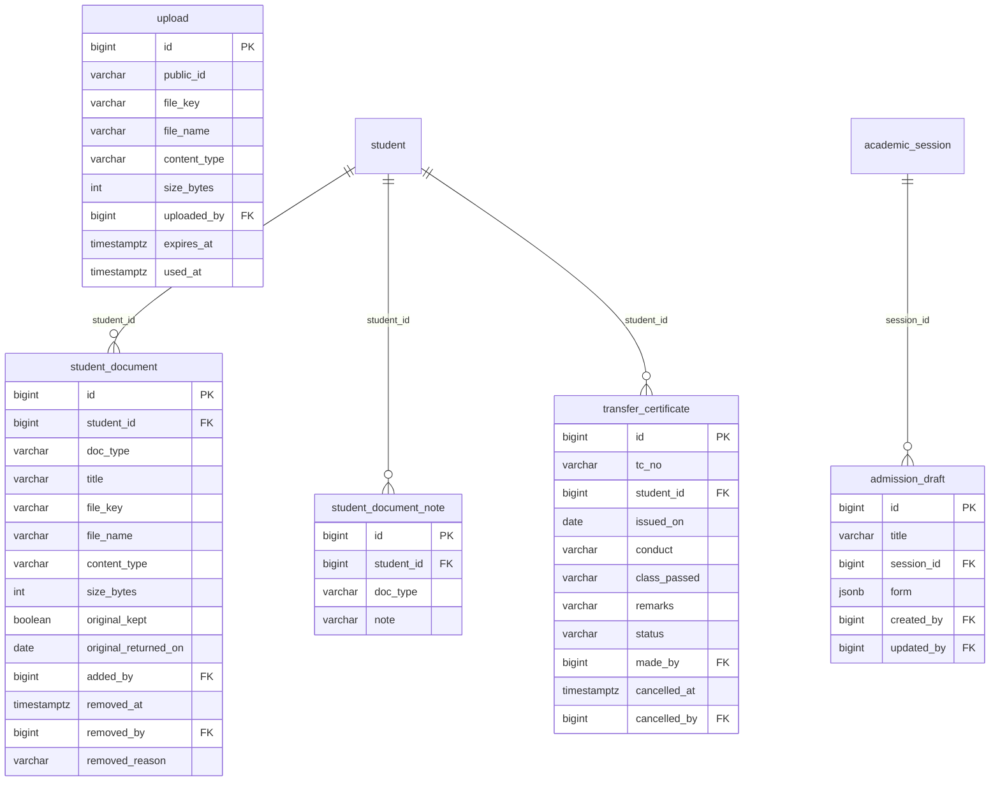

### `upload`

A file chosen on the admission form before the student exists. Gives the `uploadId`.

| Column | Type | Can be empty | Values or limits | Note |
|---|---|---|---|---|
| `id` | bigint |  |  | identity |
| `public_id` | varchar(40) |  |  | 'upl_7f3a9c2e', the uploadId of the API |
| `file_key` | varchar(200) |  |  | key in private storage |
| `file_name` | varchar(200) |  |  |  |
| `content_type` | varchar(40) |  | `application/pdf`, `image/jpeg`, `image/png` |  |
| `size_bytes` | int |  |  | up to 5 MB |
| `uploaded_by` | bigint |  |  | → `app_user` |
| `expires_at` | timestamptz |  |  | uploaded + 24 hours |
| `used_at` | timestamptz | yes |  | set when POST /admissions uses it |

Plus `created_at` and `updated_at`.

**Rules**

- Deleted by a nightly job when it is older than 24 hours and was not used.

<details><summary>Constraints and indexes in the database</summary>

- `upload_size_bytes_check`: `CHECK (((size_bytes >= 1) AND (size_bytes <= 5242880)))`
- `upload_public_id_key`: `UNIQUE (public_id)`

</details>

**Used by:** `POST /uploads`, `POST /admissions`

### `student_document`

One file of one child (birth certificate, TC, report card, ...).

| Column | Type | Can be empty | Values or limits | Note |
|---|---|---|---|---|
| `id` | bigint |  |  | identity |
| `student_id` | bigint |  |  | → `student` |
| `doc_type` | varchar(30) |  | `BIRTH_CERTIFICATE`, `PARENT_ID`, `ADDRESS_PROOF`, `TRANSFER_CERTIFICATE`, `LAST_REPORT_CARD`, `CHILD_AADHAAR`, `OTHER` |  |
| `title` | varchar(80) | yes |  | only for OTHER: 'Medical certificate' |
| `file_key` | varchar(200) |  |  |  |
| `file_name` | varchar(200) |  |  |  |
| `content_type` | varchar(40) |  | `application/pdf`, `image/jpeg`, `image/png` |  |
| `size_bytes` | int |  |  |  |
| `original_kept` | boolean |  | default `false` | the school keeps the paper original |
| `original_returned_on` | date | yes |  | given back when the child leaves |
| `added_by` | bigint |  |  | → `app_user` |
| `removed_at` | timestamptz | yes |  |  |
| `removed_by` | bigint | yes |  | → `app_user` |
| `removed_reason` | varchar(10) | yes | `REMOVED`, `REPLACED` |  |

Plus `created_at` and `updated_at`.

**Rules**

- One shown file per type (OTHER can have many). A new file for the same type sets `removed_at` on the old one, which is kept.
- Only office staff (DOCUMENTS_EDIT) can open a file. Every open is written in `audit_log`.

<details><summary>Constraints and indexes in the database</summary>

- `student_document_size_bytes_check`: `CHECK (((size_bytes >= 1) AND (size_bytes <= 5242880)))`
- `student_document_other_has_title`: `CHECK ((((doc_type)::text <> 'OTHER'::text) OR (title IS NOT NULL)))`
- `student_document_removed`: `CHECK (((removed_at IS NULL) = (removed_reason IS NULL)))`
- `student_document_student_idx`: `CREATE INDEX student_document_student_idx ON student_document (student_id)`
- `student_document_one_per_type`: `CREATE UNIQUE INDEX student_document_one_per_type ON student_document (student_id, doc_type) WHERE ((removed_at IS NULL) AND ((doc_type)::text <> 'OTHER'::text))`

</details>

**Example rows** (from the sample data)

- `id` 1 · `student_id` 118 · `doc_type` BIRTH_CERTIFICATE · `file_key` students/118/birth-certificate.jpg · `file_name` birth-certificate.jpg · `content_type` image/jpeg · `size_bytes` 1258291 · `added_by` 4
- `id` 2 · `student_id` 118 · `doc_type` PARENT_ID · `file_key` students/118/voter-card.pdf · `file_name` voter-card-sanjay-sharma.pdf · `content_type` application/pdf · `size_bytes` 389120 · `added_by` 4
- `id` 3 · `student_id` 118 · `doc_type` ADDRESS_PROOF · `file_key` students/118/electricity-bill.jpg · `file_name` electricity-bill.jpg · `content_type` image/jpeg · `size_bytes` 2202009 · `added_by` 4
- `id` 4 · `student_id` 118 · `doc_type` LAST_REPORT_CARD · `file_key` students/118/report-card.pdf · `file_name` report-card-class-3.pdf · `content_type` application/pdf · `size_bytes` 512000 · `added_by` 2

**Used by:** `/students/{id}/documents/*`, `POST /admissions`

### `student_document_note`

A note on a document type, even with no file yet. Example "The old school has not given it yet".

| Column | Type | Can be empty | Values or limits | Note |
|---|---|---|---|---|
| `id` | bigint |  |  | identity |
| `student_id` | bigint |  |  | → `student` |
| `doc_type` | varchar(30) |  | `BIRTH_CERTIFICATE`, `PARENT_ID`, `ADDRESS_PROOF`, `TRANSFER_CERTIFICATE`, `LAST_REPORT_CARD`, `CHILD_AADHAAR`, `OTHER` |  |
| `note` | varchar(200) |  |  |  |

Plus `created_at` and `updated_at`.

<details><summary>Constraints and indexes in the database</summary>

- `student_document_note_once`: `UNIQUE (student_id, doc_type)`

</details>

**Example rows** (from the sample data)

- `id` 1 · `student_id` 118 · `doc_type` TRANSFER_CERTIFICATE · `note` The old school has not given it yet

**Used by:** `PUT /students/{id}/documents/{docType}/note`

### `admission_draft`

The admission form saved with "Save as draft", exactly as the React app keeps it (jsonb).

| Column | Type | Can be empty | Values or limits | Note |
|---|---|---|---|---|
| `id` | bigint |  |  | identity |
| `title` | varchar(120) |  |  | 'Kavya Goyal, UKG' |
| `session_id` | bigint |  |  | → `academic_session` |
| `form` | jsonb |  |  |  |
| `created_by` | bigint |  |  | → `app_user` |
| `updated_by` | bigint |  |  | → `app_user` |

Plus `created_at` and `updated_at`.

**Rules**

- Nothing in `form` is checked. Deleted after 60 days, or when the admission is saved.

<details><summary>Constraints and indexes in the database</summary>

- `admission_draft_session_idx`: `CREATE INDEX admission_draft_session_idx ON admission_draft (session_id)`

</details>

**Example rows** (from the sample data)

- `id` 12 · `title` Nitin Bishnoi, Class 1 · `session_id` 4 · `form` {"family": {"father": {"name": "Mahesh Bishnoi", "phone": "99000 00... · `created_by` 4 · `updated_by` 4

**Used by:** `/admission-drafts/*`

### `transfer_certificate`

A transfer certificate, with its number.

| Column | Type | Can be empty | Values or limits | Note |
|---|---|---|---|---|
| `id` | bigint |  |  | identity |
| `tc_no` | varchar(20) |  |  |  |
| `student_id` | bigint |  |  | → `student` |
| `issued_on` | date |  |  |  |
| `conduct` | varchar(20) |  | `VERY_GOOD`, `GOOD`, `SATISFACTORY` |  |
| `class_passed` | varchar(80) | yes |  | 'Class 8, in March 2026' |
| `remarks` | varchar(200) | yes |  |  |
| `status` | varchar(10) |  | `ISSUED`, `CANCELLED` · default `ISSUED` |  |
| `made_by` | bigint |  |  | → `app_user` |
| `cancelled_at` | timestamptz | yes |  |  |
| `cancelled_by` | bigint | yes |  | → `app_user` |

Plus `created_at` and `updated_at`.

**Rules**

- One ISSUED TC per child. "Bring back" sets the TC to CANCELLED.

<details><summary>Constraints and indexes in the database</summary>

- `transfer_certificate_tc_no_check`: `CHECK (((tc_no)::text ~ '^TC-[0-9]{4}-[0-9]{3,}$'::text))`
- `transfer_certificate_cancelled`: `CHECK ((((status)::text = 'CANCELLED'::text) = (cancelled_at IS NOT NULL)))`
- `transfer_certificate_tc_no_key`: `UNIQUE (tc_no)`
- `transfer_certificate_student_idx`: `CREATE INDEX transfer_certificate_student_idx ON transfer_certificate (student_id)`
- `transfer_certificate_one_issued`: `CREATE UNIQUE INDEX transfer_certificate_one_issued ON transfer_certificate (student_id) WHERE ((status)::text = 'ISSUED'::text)`

</details>

**Used by:** `/students/{id}/transfer-certificate`, `POST /students/{id}/leave`


---

## Bus taps and holidays

Flyway file: `V4__trips.sql` · Phase 4

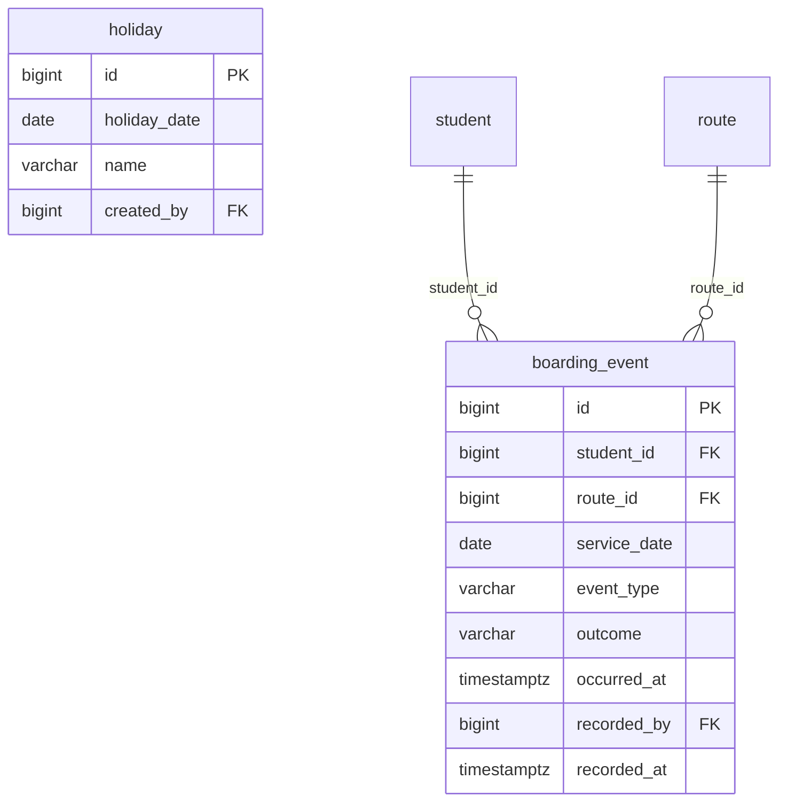

### `boarding_event`

One tap of the attendant. One child, one school day, one of the four events.

| Column | Type | Can be empty | Values or limits | Note |
|---|---|---|---|---|
| `id` | bigint |  |  | identity |
| `student_id` | bigint |  |  | → `student` |
| `route_id` | bigint |  |  | → `route`. the child's route on that day |
| `service_date` | date |  |  | the school day, Asia/Kolkata |
| `event_type` | varchar(20) |  | `BOARDED_MORNING`, `REACHED_SCHOOL`, `BOARDED_EVENING`, `REACHED_HOME` |  |
| `outcome` | varchar(20) |  | `DONE`, `ABSENT`, `NOT_TRAVELLING` |  |
| `occurred_at` | timestamptz |  |  | time of the tap ON THE PHONE |
| `recorded_by` | bigint |  |  | → `app_user` |
| `recorded_at` | timestamptz |  | default `now()` | time the server got it |

Plus `created_at` and `updated_at`.

**Rules**

- THE most important rule: `unique (student_id, service_date, event_type)`. A double tap, or a tap sent again after bad signal, hits the same row.
- Save with an upsert; the tap with the later `occurred_at` wins. A CLEARED tap (undo) deletes the row.
- NOT_TRAVELLING (went home with a parent) only for BOARDED_EVENING.

<details><summary>Constraints and indexes in the database</summary>

- `boarding_event_not_travelling_evening`: `CHECK ((((outcome)::text <> 'NOT_TRAVELLING'::text) OR ((event_type)::text = 'BOARDED_EVENING'::text)))`
- `boarding_event_one_per_event`: `UNIQUE (student_id, service_date, event_type)`
- `boarding_event_day_route_idx`: `CREATE INDEX boarding_event_day_route_idx ON boarding_event (service_date, route_id)`
- `boarding_event_route_idx`: `CREATE INDEX boarding_event_route_idx ON boarding_event (route_id, service_date)`

</details>

**Example rows** (from the sample data)

- `id` 6 · `student_id` 57 · `route_id` 4 · `service_date` 2026-10-07 · `event_type` BOARDED_MORNING · `outcome` DONE · `occurred_at` 2026-10-07 02:12 · `recorded_by` 14 · `recorded_at` 2026-10-22 19:36
- `id` 12 · `student_id` 67 · `route_id` 4 · `service_date` 2026-10-07 · `event_type` BOARDED_MORNING · `outcome` ABSENT · `occurred_at` 2026-10-07 02:13 · `recorded_by` 14 · `recorded_at` 2026-10-22 19:36

**Used by:** `POST /trips/marks`, `GET /trips/manifest`, `GET /bus-status`

### `holiday`

A day with no school (Sundays are always off and are not stored).

| Column | Type | Can be empty | Values or limits | Note |
|---|---|---|---|---|
| `id` | bigint |  |  | identity |
| `holiday_date` | date |  |  |  |
| `name` | varchar(80) |  |  | 'Diwali' |
| `created_by` | bigint |  |  | → `app_user` |

Plus `created_at` and `updated_at`.

<details><summary>Constraints and indexes in the database</summary>

- `holiday_holiday_date_key`: `UNIQUE (holiday_date)`

</details>

**Example rows** (from the sample data)

- `id` 1 · `holiday_date` 2026-10-20 · `name` Dussehra · `created_by` 1
- `id` 2 · `holiday_date` 2026-11-08 · `name` Diwali · `created_by` 1
- `id` 3 · `holiday_date` 2026-11-09 · `name` Day after Diwali · `created_by` 1

**Used by:** `/holidays`, `GET /trips/my-route`


---

## Messages to parents

Flyway file: `V5__messaging.sql` · Phase 5

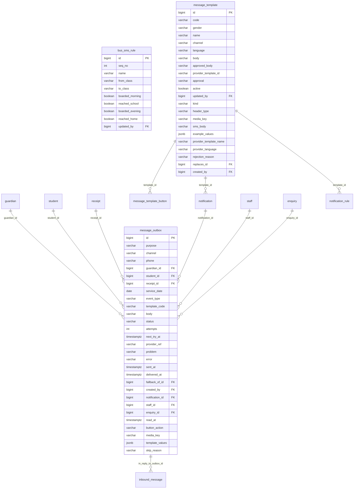

### `bus_sms_rule`

For a group of classes, which of the four bus events send an SMS.

| Column | Type | Can be empty | Values or limits | Note |
|---|---|---|---|---|
| `id` | bigint |  |  | identity |
| `seq_no` | int |  |  |  |
| `name` | varchar(60) |  |  | 'Nursery to Class 8' |
| `from_class` | varchar(10) |  | `Nursery`, `LKG`, `UKG`, `1`, `2`, `3`, `4`, `5`, `6`, `7`, `8`, `9`, `10`, `11`, `12` |  |
| `to_class` | varchar(10) |  | `Nursery`, `LKG`, `UKG`, `1`, `2`, `3`, `4`, `5`, `6`, `7`, `8`, `9`, `10`, `11`, `12` |  |
| `boarded_morning` | boolean |  |  |  |
| `reached_school` | boolean |  |  |  |
| `boarded_evening` | boolean |  |  |  |
| `reached_home` | boolean |  |  |  |
| `updated_by` | bigint | yes |  | → `app_user` |

Plus `created_at` and `updated_at`.

**Rules**

- Every class in exactly one group (checked in the service when saving).

<details><summary>Constraints and indexes in the database</summary>

- `bus_sms_rule_seq_no_key`: `UNIQUE (seq_no)`

</details>

**Example rows** (from the sample data)

- `id` 1 · `seq_no` 1 · `name` Nursery to Class 8 · `from_class` Nursery · `to_class` 8 · `boarded_morning` true · `reached_school` true · `boarded_evening` true · `reached_home` true
- `id` 2 · `seq_no` 2 · `name` Class 9 and 10 · `from_class` 9 · `to_class` 10 · `reached_school` true · `boarded_evening` true
- `id` 3 · `seq_no` 3 · `name` Class 11 and 12 · `from_class` 11 · `to_class` 12

**Used by:** `/settings/bus-sms-rules`, `POST /trips/marks`

### `message_template`

A message text. Bus texts have a boy row (M) and a girl row (F).

| Column | Type | Can be empty | Values or limits | Note |
|---|---|---|---|---|
| `id` | bigint |  |  | identity |
| `code` | varchar(40) | yes |  | 'BOARDED_MORNING' |
| `gender` | varchar(1) | yes | `M`, `F` |  |
| `name` | varchar(60) |  |  | 'Boarded morning' |
| `channel` | varchar(10) |  | `SMS`, `WHATSAPP` |  |
| `language` | varchar(5) |  | default `hi` |  |
| `body` | varchar(1000) |  |  |  |
| `approved_body` | varchar(1000) | yes |  |  |
| `provider_template_id` | varchar(60) | yes |  |  |
| `approval` | varchar(10) |  | `APPROVED`, `WAITING`, `REJECTED` · default `WAITING` |  |
| `active` | boolean |  | default `true` |  |
| `updated_by` | bigint | yes |  | → `app_user` |
| `kind` | varchar(20) |  | `SYSTEM`, `NOTICE`, `URGENT`, `MARKETING`, `GREETING`, `FEE_REMINDER`, `ONE_FAMILY`, `STAFF` |  |
| `header_type` | varchar(10) |  | `NONE`, `IMAGE`, `VIDEO`, `DOCUMENT` · default `NONE` |  |
| `media_key` | varchar(120) | yes |  |  |
| `sms_body` | varchar(320) | yes |  |  |
| `example_values` | jsonb |  | default `{}` |  |
| `provider_template_name` | varchar(60) | yes |  |  |
| `provider_language` | varchar(10) |  | default `hi` |  |
| `rejection_reason` | varchar(300) | yes |  |  |
| `replaces_id` | bigint | yes |  | → `message_template` |
| `created_by` | bigint | yes |  | → `app_user` |

Plus `created_at` and `updated_at`.

**Rules**

- `body` is the text as changed on School settings. `approved_body` is the text the phone company approved (DLT). The server always sends `approved_body`.
- One row per (code, gender) among SYSTEM texts; fee texts have gender empty (`nulls not distinct`). Notification templates (V14, kind NOTICE, MARKETING, ...) have no code.
- Editing an APPROVED notification template makes a new row (`replaces_id`).

<details><summary>Constraints and indexes in the database</summary>

- `message_template_system_has_code`: `CHECK ((((kind)::text <> 'SYSTEM'::text) OR (code IS NOT NULL)))`
- `message_template_header_media`: `CHECK ((((header_type)::text = 'NONE'::text) OR (media_key IS NOT NULL)))`
- `message_template_rejection`: `CHECK (((rejection_reason IS NULL) OR ((approval)::text = 'REJECTED'::text)))`
- `message_template_system_code`: `CREATE UNIQUE INDEX message_template_system_code ON message_template (code, gender) NULLS NOT DISTINCT WHERE ((kind)::text = 'SYSTEM'::text)`
- `message_template_kind_idx`: `CREATE INDEX message_template_kind_idx ON message_template (kind) WHERE active`
- `message_template_replaces_idx`: `CREATE INDEX message_template_replaces_idx ON message_template (replaces_id)`

</details>

**Example rows** (from the sample data)

- `id` 1 · `code` BOARDED_MORNING · `gender` M · `name` Boarded morning · `channel` SMS · `language` hi · `body` {name} सुबह की बस में चढ़ गया — {time}। MUH Jain School · `approved_body` {name} सुबह की बस में चढ़ गया — {time}। MUH Jain School · `provider_template_id` 110716123450001 · `approval` APPROVED · `active` true · `kind` SYSTEM · `header_type` NONE · `example_values` {} · `provider_language` hi
- `id` 2 · `code` BOARDED_MORNING · `gender` F · `name` Boarded morning · `channel` SMS · `language` hi · `body` {name} सुबह की बस में चढ़ गई — {time}। MUH Jain School · `approved_body` {name} सुबह की बस में चढ़ गई — {time}। MUH Jain School · `provider_template_id` 110716123450002 · `approval` APPROVED · `active` true · `kind` SYSTEM · `header_type` NONE · `example_values` {} · `provider_language` hi

**Used by:** `/message-templates/*`, `the sending job`

### `message_outbox`

Every message to a parent, as a queue. The sending job reads QUEUED rows every 5 seconds.

| Column | Type | Can be empty | Values or limits | Note |
|---|---|---|---|---|
| `id` | bigint |  |  | identity |
| `purpose` | varchar(20) |  | `BOARDING`, `FEE_RECEIPT`, `FEE_REMINDER`, `RECEIPT_CANCELLED`, `ENQUIRY`, `TEST`, `OTHER`, `NOTICE`, `MARKETING`, `URGENT`, `STAFF`, `ONE_FAMILY` |  |
| `channel` | varchar(10) |  | `SMS`, `WHATSAPP` |  |
| `phone` | varchar(13) |  |  |  |
| `guardian_id` | bigint | yes |  | → `guardian` |
| `student_id` | bigint | yes |  | → `student`. empty for a family message (receipt for two children) |
| `receipt_id` | bigint | yes |  | → `receipt`. foreign key added in V7 |
| `service_date` | date | yes |  | bus messages |
| `event_type` | varchar(20) | yes | `BOARDED_MORNING`, `REACHED_SCHOOL`, `BOARDED_EVENING`, `REACHED_HOME` |  |
| `template_code` | varchar(40) | yes |  |  |
| `body` | varchar(1024) |  |  | the final text |
| `status` | varchar(12) |  | `QUEUED`, `SENT`, `DELIVERED`, `FAILED`, `CANCELLED`, `TEST_ONLY`, `SKIPPED` · default `QUEUED` |  |
| `attempts` | int |  | default `0` |  |
| `next_try_at` | timestamptz |  | default `now()` |  |
| `provider_ref` | varchar(120) | yes |  | id from the SMS / WhatsApp company |
| `problem` | varchar(20) | yes | `PHONE_OFF`, `WRONG_NUMBER`, `NOT_ON_WHATSAPP`, `DND`, `PROVIDER_ERROR`, `OTHER` |  |
| `error` | varchar(300) | yes |  |  |
| `sent_at` | timestamptz | yes |  |  |
| `delivered_at` | timestamptz | yes |  |  |
| `fallback_of_id` | bigint | yes |  | → `message_outbox`. this SMS went because that WhatsApp failed |
| `created_by` | bigint | yes |  | → `app_user`. empty = made by the system (a tap) |
| `notification_id` | bigint | yes |  | → `notification` |
| `staff_id` | bigint | yes |  | → `staff` |
| `enquiry_id` | bigint | yes |  | → `enquiry` |
| `read_at` | timestamptz | yes |  |  |
| `button_action` | varchar(30) | yes | `STOP_MESSAGES`, `BOOK_VISIT`, `GOT_IT`, `CALL_ME` |  |
| `media_key` | varchar(120) | yes |  |  |
| `template_values` | jsonb |  | default `{}` |  |
| `skip_reason` | varchar(30) | yes |  |  |

Plus `created_at` and `updated_at`.

**Rules**

- One bus event gives one SMS per phone, whatever happens (partial unique index).
- Login codes are never stored here.
- After 3 failed tries a row is FAILED. If WhatsApp fails, a new SMS row is made with `fallback_of_id`.
- A notification gives one row per phone per channel (URGENT has WhatsApp and SMS). A guard that says no makes a SKIPPED row with `skip_reason`.

<details><summary>Constraints and indexes in the database</summary>

- `message_outbox_phone_check`: `CHECK (((phone)::text ~ '^\+91[6-9][0-9]{9}$'::text))`
- `message_outbox_attempts_check`: `CHECK (((attempts >= 0) AND (attempts <= 10)))`
- `message_outbox_bus_fields`: `CHECK ((((purpose)::text <> 'BOARDING'::text) OR ((student_id IS NOT NULL) AND (service_date IS NOT NULL) AND (event_type IS NOT NULL))))`
- `message_outbox_skip_reason`: `CHECK ((((status)::text = 'SKIPPED'::text) = (skip_reason IS NOT NULL)))`
- `message_outbox_one_bus_sms`: `CREATE UNIQUE INDEX message_outbox_one_bus_sms ON message_outbox (guardian_id, student_id, service_date, event_type) WHERE (((purpose)::text = 'BOARDING'::text) AND (fallback_of_id IS NULL))`
- `message_outbox_queue_idx`: `CREATE INDEX message_outbox_queue_idx ON message_outbox (next_try_at) WHERE ((status)::text = 'QUEUED'::text)`
- `message_outbox_day_idx`: `CREATE INDEX message_outbox_day_idx ON message_outbox (created_at DESC)`
- `message_outbox_provider_idx`: `CREATE INDEX message_outbox_provider_idx ON message_outbox (provider_ref) WHERE (provider_ref IS NOT NULL)`
- `message_outbox_student_idx`: `CREATE INDEX message_outbox_student_idx ON message_outbox (student_id)`
- `message_outbox_guardian_idx`: `CREATE INDEX message_outbox_guardian_idx ON message_outbox (guardian_id, purpose, created_at DESC)`
- `message_outbox_receipt_idx`: `CREATE INDEX message_outbox_receipt_idx ON message_outbox (receipt_id)`
- `message_outbox_fallback_idx`: `CREATE INDEX message_outbox_fallback_idx ON message_outbox (fallback_of_id)`
- `message_outbox_one_per_phone`: `CREATE UNIQUE INDEX message_outbox_one_per_phone ON message_outbox (notification_id, phone, channel) WHERE ((notification_id IS NOT NULL) AND (fallback_of_id IS NULL) AND ((purpose)::text <> 'TEST'::text))`
- `message_outbox_notification_idx`: `CREATE INDEX message_outbox_notification_idx ON message_outbox (notification_id, status)`
- `message_outbox_staff_idx`: `CREATE INDEX message_outbox_staff_idx ON message_outbox (staff_id)`
- `message_outbox_enquiry_idx`: `CREATE INDEX message_outbox_enquiry_idx ON message_outbox (enquiry_id)`

</details>

**Example rows** (from the sample data)

- `id` 3 · `purpose` BOARDING · `channel` SMS · `phone` +919400000871 · `guardian_id` 210 · `student_id` 57 · `service_date` 2026-10-07 · `event_type` BOARDED_MORNING · `template_code` BOARDED_MORNING · `body` आर्यन सुबह 7:42 बजे बस में चढ़ गया। – MUH Jain School · `status` DELIVERED · `attempts` 1 · `next_try_at` 2026-10-22 19:36 · `provider_ref` msg-8f2c-7741 · `sent_at` 2026-10-07 02:12 · `delivered_at` 2026-10-07 02:12 · `template_values` {}
- `id` 4 · `purpose` BOARDING · `channel` SMS · `phone` +919800000512 · `guardian_id` 211 · `student_id` 57 · `service_date` 2026-10-07 · `event_type` BOARDED_MORNING · `template_code` BOARDED_MORNING · `body` आर्यन सुबह 7:42 बजे बस में चढ़ गया। – MUH Jain School · `status` DELIVERED · `attempts` 1 · `next_try_at` 2026-10-22 19:36 · `provider_ref` msg-8f2c-7742 · `sent_at` 2026-10-07 02:12 · `delivered_at` 2026-10-07 02:12 · `template_values` {}
- `id` 7 · `purpose` FEE_RECEIPT · `channel` WHATSAPP · `phone` +919700000209 · `guardian_id` 240 · `receipt_id` 30 · `template_code` FEE_RECEIPT · `body` फ़ीस ₹3300 मिल गई है। रसीद नंबर R-2026-1187 साथ में भेजी है। धन्यवा... · `status` DELIVERED · `attempts` 1 · `next_try_at` 2026-10-22 19:36 · `sent_at` 2026-10-07 05:13 · `delivered_at` 2026-10-07 05:13 · `created_by` 2 · `template_values` {}
- `id` 8 · `purpose` FEE_RECEIPT · `channel` WHATSAPP · `phone` +919800000665 · `guardian_id` 241 · `receipt_id` 29 · `template_code` FEE_RECEIPT · `body` फ़ीस ₹8000 मिल गई है। रसीद नंबर R-2026-1186 साथ में भेजी है। धन्यवा... · `status` DELIVERED · `attempts` 1 · `next_try_at` 2026-10-22 19:36 · `sent_at` 2026-10-07 04:46 · `delivered_at` 2026-10-07 04:46 · `created_by` 2 · `template_values` {}

**Used by:** `GET /messages`, `POST /messages/*/retry`, `webhooks`, `receipts on WhatsApp`, `reminders`


---

## Notifications to parents and staff

Flyway file: `V14__notifications.sql` · Phase 11

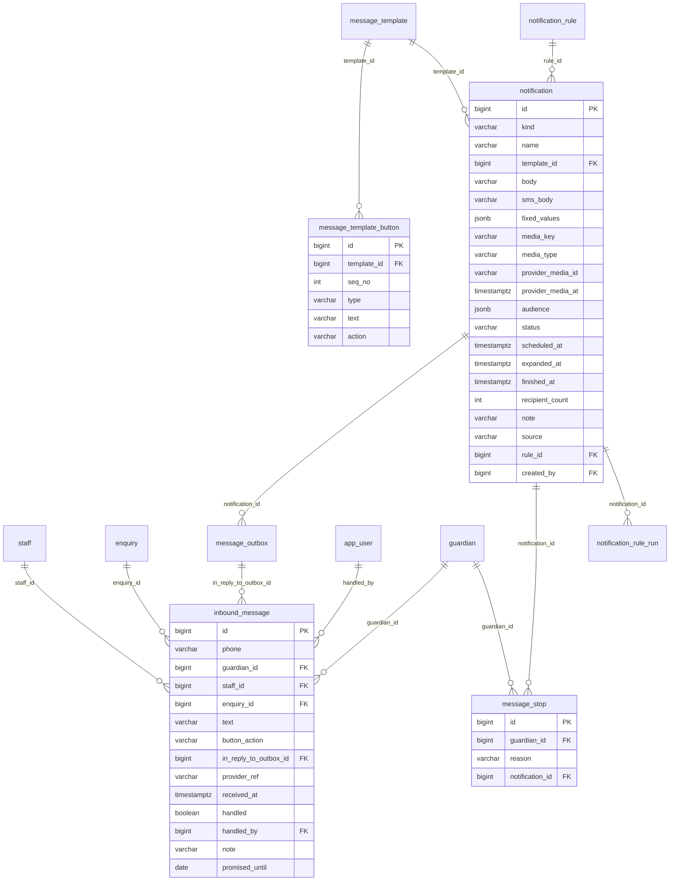

### `notification`

One send by the office (notice, urgent, marketing, greeting, fee reminder, one family, staff). The people are rows in message_outbox with this notification_id.

| Column | Type | Can be empty | Values or limits | Note |
|---|---|---|---|---|
| `id` | bigint |  |  | identity |
| `kind` | varchar(20) |  | `NOTICE`, `URGENT`, `MARKETING`, `GREETING`, `FEE_REMINDER`, `ONE_FAMILY`, `STAFF` |  |
| `name` | varchar(80) |  |  | office-only name: "Open day, Sunday 25 October" |
| `template_id` | bigint |  |  | → `message_template` |
| `body` | varchar(1024) |  |  | the text with {boxes}, as the office saw it |
| `sms_body` | varchar(320) | yes |  | SMS version, null = no SMS fallback |
| `fixed_values` | jsonb |  | default `{}` | {Date}: "10 अक्टूबर" — same for everyone |
| `media_key` | varchar(120) | yes |  | our storage key (poster, video, pdf) |
| `media_type` | varchar(10) | yes | `IMAGE`, `VIDEO`, `DOCUMENT`, `AUDIO` |  |
| `provider_media_id` | varchar(120) | yes |  | filled by MediaPublisher at send time |
| `provider_media_at` | timestamptz | yes |  | when it was uploaded; re-upload after 25 days |
| `audience` | jsonb |  |  | groups + filter |
| `status` | varchar(12) |  | `DRAFT`, `SCHEDULED`, `SENDING`, `SENT`, `CANCELLED`, `FAILED` · default `DRAFT` |  |
| `scheduled_at` | timestamptz | yes |  |  |
| `expanded_at` | timestamptz | yes |  | when the outbox rows were written |
| `finished_at` | timestamptz | yes |  | when the last row left QUEUED |
| `recipient_count` | int | yes | `>= 0` | counted at expand time |
| `note` | varchar(300) | yes |  | "Cancelled while sending: 112 sent, 134 not sent" |
| `source` | varchar(10) |  | `MANUAL`, `RULE` · default `MANUAL` |  |
| `rule_id` | bigint | yes |  | → `notification_rule`. Phase 12: notification_rule (foreign key added there) |
| `created_by` | bigint |  |  | → `app_user` |

Plus `created_at` and `updated_at`.

**Rules**

- Rows are written by NotificationDispatcher (every 60 s), never by the request. "Send now" only sets SENDING.
- `audience` is the question ("families with dues, 2+ months"), never the answer. The list is made at expand time and checked again before each send.
- SCHEDULED needs `scheduled_at`. A file needs its `media_type`. `rule_id` only for `source = RULE` (Phase 12).
- No cost, price or budget column.

<details><summary>Constraints and indexes in the database</summary>

- `notification_schedule`: `CHECK ((((status)::text <> 'SCHEDULED'::text) OR (scheduled_at IS NOT NULL)))`
- `notification_media`: `CHECK (((media_key IS NULL) = (media_type IS NULL)))`
- `notification_rule_source`: `CHECK ((((source)::text = 'RULE'::text) OR (rule_id IS NULL)))`
- `notification_due_idx`: `CREATE INDEX notification_due_idx ON notification (scheduled_at) WHERE ((status)::text = 'SCHEDULED'::text)`
- `notification_open_idx`: `CREATE INDEX notification_open_idx ON notification (status) WHERE ((status)::text = 'SENDING'::text)`
- `notification_list_idx`: `CREATE INDEX notification_list_idx ON notification (created_at DESC)`
- `notification_template_idx`: `CREATE INDEX notification_template_idx ON notification (template_id)`
- `notification_rule_idx`: `CREATE INDEX notification_rule_idx ON notification (rule_id) WHERE (rule_id IS NOT NULL)`

</details>

**Used by:** `POST /notifications`, `POST /notifications/{id}/send`, `GET /notifications/{id}/report`

### `message_template_button`

Up to 3 WhatsApp buttons under a notification template.

| Column | Type | Can be empty | Values or limits | Note |
|---|---|---|---|---|
| `id` | bigint |  |  | identity |
| `template_id` | bigint |  |  | → `message_template` |
| `seq_no` | int |  |  |  |
| `type` | varchar(10) |  | `CALL`, `URL`, `REPLY` |  |
| `text` | varchar(25) |  |  | WhatsApp's limit for a button |
| `action` | varchar(300) |  |  |  |

Plus `created_at` and `updated_at`.

**Rules**

- REPLY → action STOP_MESSAGES, BOOK_VISIT, GOT_IT or CALL_ME. CALL → a +91 phone. URL → an https link.
- A MARKETING or GREETING template always ends with REPLY STOP_MESSAGES (added by the server).

<details><summary>Constraints and indexes in the database</summary>

- `message_template_button_seq_no_check`: `CHECK (((seq_no >= 1) AND (seq_no <= 3)))`
- `message_template_button_action`: `CHECK (((((type)::text = 'REPLY'::text) AND ((action)::text = ANY ((ARRAY['STOP_MESSAGES'::character varying, 'BOOK_VISIT'::character varying, 'GOT_IT'::character varying, 'CALL_ME'::character varying])::text[]))) OR (((type)::text = 'CALL'::text) AND ((action)::text ~ '^\+91[6-9][0-9]{9}$'::text)) OR (((type)::text = 'URL'::text) AND ((action)::text ~ '^https://'::text))))`
- `message_template_button_once`: `UNIQUE (template_id, seq_no)`

</details>

**Used by:** `POST /notification-templates`

### `message_stop`

Families who said stop to MARKETING and GREETING. They still get notices, urgent messages, fee reminders, bus SMS and receipts.

| Column | Type | Can be empty | Values or limits | Note |
|---|---|---|---|---|
| `id` | bigint |  |  | identity |
| `guardian_id` | bigint |  |  | → `guardian` |
| `reason` | varchar(20) |  | `TAPPED_BUTTON`, `WROTE_STOP` |  |
| `notification_id` | bigint | yes |  | → `notification`. the message they answered, if known |

Plus `created_at` and `updated_at`.

**Rules**

- One row per guardian (unique). Taking a family off the list deletes the row.

<details><summary>Constraints and indexes in the database</summary>

- `message_stop_guardian_id_key`: `UNIQUE (guardian_id)`
- `message_stop_notification_idx`: `CREATE INDEX message_stop_notification_idx ON message_stop (notification_id)`

</details>

**Used by:** `GET /message-stops`, `webhooks/inbound`

### `inbound_message`

Every WhatsApp message that comes in to the school number. Used for STOP, button taps, the 24-hour window and "promised to pay by".

| Column | Type | Can be empty | Values or limits | Note |
|---|---|---|---|---|
| `id` | bigint |  |  | identity |
| `phone` | varchar(16) |  |  |  |
| `guardian_id` | bigint | yes |  | → `guardian` |
| `staff_id` | bigint | yes |  | → `staff` |
| `enquiry_id` | bigint | yes |  | → `enquiry` |
| `text` | varchar(4096) | yes |  | null for a button tap |
| `button_action` | varchar(30) | yes | `STOP_MESSAGES`, `BOOK_VISIT`, `GOT_IT`, `CALL_ME` |  |
| `in_reply_to_outbox_id` | bigint | yes |  | → `message_outbox` |
| `provider_ref` | varchar(120) |  |  | the same webhook twice saves one row |
| `received_at` | timestamptz |  |  |  |
| `handled` | boolean |  | default `false` |  |
| `handled_by` | bigint | yes |  | → `app_user`. empty + handled = done by the server (STOP) |
| `note` | varchar(300) | yes |  |  |
| `promised_until` | date | yes |  | "will pay by Friday": no fee reminder until then |

Plus `created_at` and `updated_at`.

**Rules**

- `provider_ref` is unique: the same webhook twice saves one row.
- A text or a button tap, at least one. Any country's phone is saved.
- `promised_until` set → no fee reminder to this family until that day.

<details><summary>Constraints and indexes in the database</summary>

- `inbound_message_phone_check`: `CHECK (((phone)::text ~ '^\+[1-9][0-9]{6,14}$'::text))`
- `inbound_message_has_content`: `CHECK (((text IS NOT NULL) OR (button_action IS NOT NULL)))`
- `inbound_message_provider_ref_key`: `UNIQUE (provider_ref)`
- `inbound_message_phone_idx`: `CREATE INDEX inbound_message_phone_idx ON inbound_message (phone, received_at DESC)`
- `inbound_message_open_idx`: `CREATE INDEX inbound_message_open_idx ON inbound_message (received_at DESC) WHERE (NOT handled)`
- `inbound_message_guardian_idx`: `CREATE INDEX inbound_message_guardian_idx ON inbound_message (guardian_id)`
- `inbound_message_promised_idx`: `CREATE INDEX inbound_message_promised_idx ON inbound_message (guardian_id, promised_until) WHERE (promised_until IS NOT NULL)`
- `inbound_message_reply_to_idx`: `CREATE INDEX inbound_message_reply_to_idx ON inbound_message (in_reply_to_outbox_id)`

</details>

**Used by:** `GET /inbound-messages`, `webhooks/inbound`


---

## Automatic messages (rules)

Flyway file: `V15__notification_rules.sql` · Phase 12

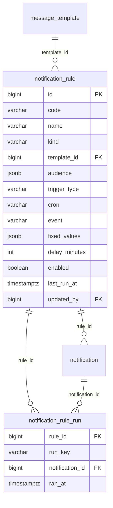

### `notification_rule`

One automatic message, a line of the Settings screen's "Automatic messages" table. At the right moment it makes a normal notification (source RULE); it never sends anything itself.

| Column | Type | Can be empty | Values or limits | Note |
|---|---|---|---|---|
| `id` | bigint |  |  | identity |
| `code` | varchar(40) |  |  | 'FEE_REMINDER_10TH', 'BIRTHDAY', 'BUS_LATE', 'WELCOME' |
| `name` | varchar(80) |  |  | the sender on Home: "Automatic · Fee reminder 10th" |
| `kind` | varchar(20) |  | `NOTICE`, `URGENT`, `MARKETING`, `GREETING`, `FEE_REMINDER`, `ONE_FAMILY`, `STAFF` |  |
| `template_id` | bigint | yes |  | → `message_template` |
| `audience` | jsonb |  |  | same shape as notification.audience |
| `trigger_type` | varchar(10) |  | `CRON`, `EVENT` |  |
| `cron` | varchar(60) | yes |  | Spring cron, zone Asia/Kolkata: '0 0 10 10 * *' |
| `event` | varchar(30) | yes | `ADMISSION_SAVED`, `BUS_LATE`, `NO_MORNING_TAP`, `PAYMENT_SAVED` |  |
| `fixed_values` | jsonb |  | default `{}` | FESTIVAL: {"dates": ["2027-03-04"], "Festival": {"2027-03-04": "होली"}} |
| `delay_minutes` | int | yes | `>= 0` | send later, not at once |
| `enabled` | boolean |  | default `false` |  |
| `last_run_at` | timestamptz | yes |  |  |
| `updated_by` | bigint | yes |  | → `app_user` |

Plus `created_at` and `updated_at`.

**Rules**

- The 8 rows come from V15 (all off, no template) and are never added or deleted from the API.
- A rule can be on only with a template (database check); the server also wants it approved and an audience with a group.
- CRON rules have a cron (built by the server from DAILY / WEEKLY / MONTHLY choices, school time); EVENT rules have an event. Never both.
- FESTIVAL keeps its dates and names in `fixed_values` and fires only on those dates.
- `updated_by` is the user who last turned it on or changed it: the "made by" of its notifications.

<details><summary>Constraints and indexes in the database</summary>

- `notification_rule_trigger`: `CHECK (((((trigger_type)::text = 'CRON'::text) = (cron IS NOT NULL)) AND (((trigger_type)::text = 'EVENT'::text) = (event IS NOT NULL))))`
- `notification_rule_enabled_template`: `CHECK (((NOT enabled) OR (template_id IS NOT NULL)))`
- `notification_rule_code_key`: `UNIQUE (code)`
- `notification_rule_template_idx`: `CREATE INDEX notification_rule_template_idx ON notification_rule (template_id)`

</details>

**Example rows** (from the sample data)

- `id` 1 · `code` FEE_REMINDER_10TH · `name` Fee reminder 10th · `kind` FEE_REMINDER · `audience` {"filter": {"skipPromised": true}, "groups": ["FAMILIES_WITH_DUES"]} · `trigger_type` CRON · `cron` 0 0 10 10 * * · `fixed_values` {}
- `id` 4 · `code` FESTIVAL · `name` Festival greeting · `kind` GREETING · `audience` {"filter": {}, "groups": ["CURRENT_PARENTS", "STAFF_ALL"]} · `trigger_type` CRON · `cron` 0 0 9 * * * · `fixed_values` {"dates": [], "Festival": {}}
- `id` 5 · `code` WELCOME · `name` Welcome after admission · `kind` ONE_FAMILY · `audience` {"filter": {}, "groups": ["ONE_FAMILY"]} · `trigger_type` EVENT · `event` ADMISSION_SAVED · `fixed_values` {}

**Used by:** `GET /notification-rules`, `PUT /notification-rules/{id}`, `POST /notification-rules/{id}/run-now`, `RuleScheduler`, `RuleEventListener`

### `notification_rule_run`

One run of a rule. The primary key (rule, run key) stops the same run from happening twice, even after a restart.

| Column | Type | Can be empty | Values or limits | Note |
|---|---|---|---|---|
| `rule_id` | bigint |  |  | → `notification_rule` |
| `run_key` | varchar(60) |  |  |  |
| `notification_id` | bigint | yes |  | → `notification`. null when the run found nobody to send to |
| `ran_at` | timestamptz |  | default `now()` |  |

Plus `created_at` and `updated_at`.

**Rules**

- Run keys: timed rules (birthday too) the school day `2026-10-10`; WELCOME `student:129`; BUS_LATE `bus-late:4:2026-10-07:morning`; Run now `manual:<time>`.
- `notification_id` is empty when the run found nobody to send to.
- Written only with insert ... on conflict do nothing, in the same transaction as the notification.

<details><summary>Constraints and indexes in the database</summary>

- `notification_rule_run_notification_idx`: `CREATE INDEX notification_rule_run_notification_idx ON notification_rule_run (notification_id)`

</details>

**Used by:** `RuleService.fire`


---

## Enquiries

Flyway file: `V6__enquiries.sql` · Phase 6

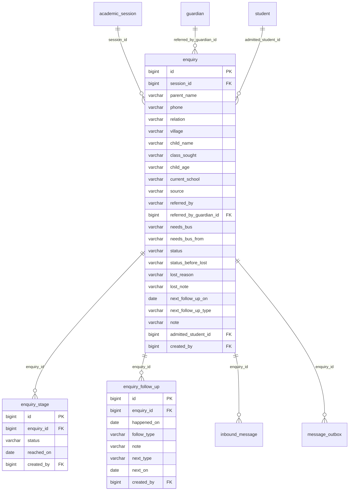

### `enquiry`

A parent who asked about admission, and where they are now.

| Column | Type | Can be empty | Values or limits | Note |
|---|---|---|---|---|
| `id` | bigint |  |  | identity |
| `session_id` | bigint |  |  | → `academic_session`. the year the child wants to join |
| `parent_name` | varchar(120) |  |  |  |
| `phone` | varchar(13) |  |  |  |
| `relation` | varchar(20) | yes | `FATHER`, `MOTHER`, `GRANDFATHER`, `GRANDMOTHER`, `UNCLE_AUNT`, `OTHER` |  |
| `village` | varchar(80) |  |  |  |
| `child_name` | varchar(120) | yes |  |  |
| `class_sought` | varchar(10) |  | `Nursery`, `LKG`, `UKG`, `1`, `2`, `3`, `4`, `5`, `6`, `7`, `8`, `9`, `10`, `11`, `12` |  |
| `child_age` | varchar(20) | yes |  | free text: '6 years' |
| `current_school` | varchar(120) | yes |  |  |
| `source` | varchar(20) |  | `WALK_IN`, `REFERRAL`, `FACEBOOK`, `WHATSAPP`, `HOARDING`, `BUS_ENQUIRY` |  |
| `referred_by` | varchar(120) | yes |  | name typed by the office |
| `referred_by_guardian_id` | bigint | yes |  | → `guardian`. a known parent: gets the referral credit |
| `needs_bus` | varchar(10) |  | `YES`, `NO`, `UNKNOWN` · default `UNKNOWN` |  |
| `needs_bus_from` | varchar(80) | yes |  | 'Model Town' |
| `status` | varchar(12) |  | `NEW`, `CONTACTED`, `VISITED`, `APPLIED`, `ADMITTED`, `LOST` · default `NEW` |  |
| `status_before_lost` | varchar(12) | yes | `NEW`, `CONTACTED`, `VISITED`, `APPLIED` | for "Open the enquiry again" |
| `lost_reason` | varchar(30) | yes | `FEE_TOO_HIGH`, `CHOSE_OTHER_SCHOOL`, `TOO_FAR_NO_BUS`, `NO_SEAT`, `NOT_REACHABLE`, `OTHER` |  |
| `lost_note` | varchar(300) | yes |  |  |
| `next_follow_up_on` | date | yes |  |  |
| `next_follow_up_type` | varchar(10) | yes | `CALL`, `VISIT`, `DOCUMENTS` |  |
| `note` | varchar(1000) | yes |  |  |
| `admitted_student_id` | bigint | yes |  | → `student` |
| `created_by` | bigint |  |  | → `app_user` |

Plus `created_at` and `updated_at`.

**Rules**

- LOST needs a reason, and keeps the stage before it (for "Open the enquiry again").
- ADMITTED is set only by POST /admissions, with the new student's id.
- "Overdue" is counted: `next_follow_up_on` before today, and not ADMITTED or LOST.

<details><summary>Constraints and indexes in the database</summary>

- `enquiry_phone_check`: `CHECK (((phone)::text ~ '^\+91[6-9][0-9]{9}$'::text))`
- `enquiry_lost_has_reason`: `CHECK ((((status)::text <> 'LOST'::text) OR ((lost_reason IS NOT NULL) AND (status_before_lost IS NOT NULL))))`
- `enquiry_admitted_has_student`: `CHECK ((((status)::text = 'ADMITTED'::text) = (admitted_student_id IS NOT NULL)))`
- `enquiry_admitted_student_id_key`: `UNIQUE (admitted_student_id)`
- `enquiry_session_status_idx`: `CREATE INDEX enquiry_session_status_idx ON enquiry (session_id, status)`
- `enquiry_phone_idx`: `CREATE INDEX enquiry_phone_idx ON enquiry (phone)`
- `enquiry_follow_up_idx`: `CREATE INDEX enquiry_follow_up_idx ON enquiry (next_follow_up_on) WHERE ((status)::text <> ALL ((ARRAY['ADMITTED'::character varying, 'LOST'::character varying])::text[]))`
- `enquiry_referred_by_idx`: `CREATE INDEX enquiry_referred_by_idx ON enquiry (referred_by_guardian_id)`

</details>

**Example rows** (from the sample data)

- `id` 74 · `session_id` 4 · `parent_name` Meena Kumari · `phone` +919700000649 · `relation` MOTHER · `village` Jakhal · `class_sought` Nursery · `source` FACEBOOK · `needs_bus` UNKNOWN · `status` LOST · `status_before_lost` CONTACTED · `lost_reason` FEE_TOO_HIGH · `created_by` 4
- `id` 77 · `session_id` 4 · `parent_name` Anita Goyal · `phone` +919800000771 · `relation` MOTHER · `village` Tohana town · `child_name` Kavya · `class_sought` UKG · `child_age` 4 years · `current_school` Little Stars Play School · `source` WALK_IN · `needs_bus` YES · `needs_bus_from` Model Town · `status` ADMITTED · `note` Father Rakesh Goyal is a shopkeeper. Elder cousin studies here in C... · `admitted_student_id` 140 · `created_by` 4

**Used by:** `/enquiries/*`, `POST /admissions`

### `enquiry_stage`

Each stage an enquiry reached, with its date. For the stage line "New 29 Sep → Contacted 2 Oct".

| Column | Type | Can be empty | Values or limits | Note |
|---|---|---|---|---|
| `id` | bigint |  |  | identity |
| `enquiry_id` | bigint |  |  | → `enquiry` |
| `status` | varchar(12) |  | `NEW`, `CONTACTED`, `VISITED`, `APPLIED`, `ADMITTED`, `LOST` |  |
| `reached_on` | date |  |  |  |
| `created_by` | bigint |  |  | → `app_user` |

Plus `created_at` and `updated_at`.

<details><summary>Constraints and indexes in the database</summary>

- `enquiry_stage_enquiry_idx`: `CREATE INDEX enquiry_stage_enquiry_idx ON enquiry_stage (enquiry_id, reached_on)`

</details>

**Example rows** (from the sample data)

- `id` 1 · `enquiry_id` 77 · `status` NEW · `reached_on` 2026-09-29 · `created_by` 4
- `id` 2 · `enquiry_id` 77 · `status` CONTACTED · `reached_on` 2026-10-02 · `created_by` 4
- `id` 3 · `enquiry_id` 77 · `status` VISITED · `reached_on` 2026-10-06 · `created_by` 2
- `id` 4 · `enquiry_id` 77 · `status` APPLIED · `reached_on` 2026-10-06 · `created_by` 2

**Used by:** `GET /enquiries/{id}`, `POST /enquiries/{id}/status`

### `enquiry_follow_up`

One call, visit or chat, and the next step that was promised.

| Column | Type | Can be empty | Values or limits | Note |
|---|---|---|---|---|
| `id` | bigint |  |  | identity |
| `enquiry_id` | bigint |  |  | → `enquiry` |
| `happened_on` | date |  |  |  |
| `follow_type` | varchar(10) |  | `CALL`, `VISIT`, `WALK_IN`, `WHATSAPP` |  |
| `note` | varchar(1000) |  |  |  |
| `next_type` | varchar(10) | yes | `CALL`, `VISIT`, `DOCUMENTS` |  |
| `next_on` | date | yes |  |  |
| `created_by` | bigint |  |  | → `app_user` |

Plus `created_at` and `updated_at`.

<details><summary>Constraints and indexes in the database</summary>

- `enquiry_follow_up_enquiry_idx`: `CREATE INDEX enquiry_follow_up_enquiry_idx ON enquiry_follow_up (enquiry_id, happened_on DESC)`

</details>

**Example rows** (from the sample data)

- `id` 1 · `enquiry_id` 77 · `happened_on` 2026-09-29 · `follow_type` WALK_IN · `note` Wants UKG for Kavya next year. Gave her the fee sheet. · `next_type` CALL · `next_on` 2026-10-02 · `created_by` 4
- `id` 2 · `enquiry_id` 77 · `happened_on` 2026-10-02 · `follow_type` CALL · `note` Asked about the bus from Model Town. Told her Route 9 is full now a... · `next_type` VISIT · `next_on` 2026-10-06 · `created_by` 4
- `id` 3 · `enquiry_id` 77 · `happened_on` 2026-10-06 · `follow_type` VISIT · `note` Came with Kavya and saw the classroom. Filled the form. Will bring ... · `next_type` DOCUMENTS · `next_on` 2026-10-10 · `created_by` 2

**Used by:** `POST /enquiries/{id}/follow-ups`


---

## Fees, month by month

Flyway file: `V7__fees.sql` · Phase 7

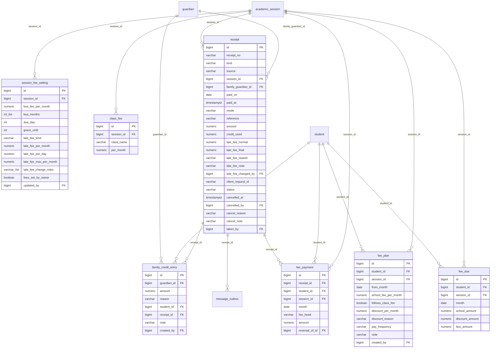

### `session_fee_setting`

The fee rules of one session. One row per session.

| Column | Type | Can be empty | Values or limits | Note |
|---|---|---|---|---|
| `id` | bigint |  |  | identity |
| `session_id` | bigint |  |  | → `academic_session` |
| `bus_fee_per_month` | numeric(12,2) |  | `>= 0` |  |
| `bus_months` | int[] |  |  |  |
| `due_day` | int |  | default `1` |  |
| `grace_until` | int |  | default `10` | 31 = end of the month |
| `late_fee_kind` | varchar(10) |  | `NONE`, `PER_MONTH`, `PER_DAY` · default `PER_MONTH` |  |
| `late_fee_per_month` | numeric(12,2) | yes | `>= 0` |  |
| `late_fee_per_day` | numeric(12,2) | yes | `>= 0` |  |
| `late_fee_max_per_month` | numeric(12,2) | yes | `>= 0` |  |
| `late_fee_change_roles` | varchar[] |  | default `{OWNER,OFFICE_ADMIN}` |  |
| `fees_set_by_owner` | boolean |  | default `false` | false = copied from the year before, not checked yet |
| `updated_by` | bigint | yes |  | → `app_user` |

Plus `created_at` and `updated_at`.

**Rules**

- `bus_months` holds the months with a bus fee: {4,5,7,8,9,10,11,12,1,2,3} means no bus fee in June.
- `grace_until` 31 means "until the end of the month".
- A new session copies the row of the year before, with `fees_set_by_owner = false`.

<details><summary>Constraints and indexes in the database</summary>

- `session_fee_setting_bus_months_check`: `CHECK (((bus_months <@ ARRAY[1, 2, 3, 4, 5, 6, 7, 8, 9, 10, 11, 12]) AND (cardinality(bus_months) <= 12)))`
- `session_fee_setting_late_fee_change_roles_check`: `CHECK ((late_fee_change_roles <@ ARRAY['OWNER'::character varying(30), 'OFFICE_ADMIN'::character varying(30), 'ADMISSIONS_DESK'::character varying(30)]))`
- `session_fee_setting_per_month`: `CHECK ((((late_fee_kind)::text <> 'PER_MONTH'::text) OR (late_fee_per_month IS NOT NULL)))`
- `session_fee_setting_per_day`: `CHECK ((((late_fee_kind)::text <> 'PER_DAY'::text) OR ((late_fee_per_day IS NOT NULL) AND (late_fee_max_per_month IS NOT NULL))))`
- `session_fee_setting_session_id_key`: `UNIQUE (session_id)`

</details>

**Example rows** (from the sample data)

- `id` 2 · `session_id` 3 · `bus_fee_per_month` 800.00 · `bus_months` [4, 5, 7, 8, 9, 10, 11, 12, 1, 2, 3] · `due_day` 1 · `grace_until` 10 · `late_fee_kind` PER_MONTH · `late_fee_per_month` 100.00 · `late_fee_per_day` 10.00 · `late_fee_max_per_month` 300.00 · `late_fee_change_roles` ["OWNER", "OFFICE_ADMIN"] · `fees_set_by_owner` true · `updated_by` 1
- `id` 3 · `session_id` 4 · `bus_fee_per_month` 800.00 · `bus_months` [4, 5, 7, 8, 9, 10, 11, 12, 1, 2, 3] · `due_day` 1 · `grace_until` 10 · `late_fee_kind` PER_MONTH · `late_fee_per_month` 100.00 · `late_fee_per_day` 10.00 · `late_fee_max_per_month` 300.00 · `late_fee_change_roles` ["OWNER", "OFFICE_ADMIN"] · `updated_by` 1

**Used by:** `/sessions/{id}/fee-settings`, `every fee calculation`

### `class_fee`

The school fee a month for one class in one session.

| Column | Type | Can be empty | Values or limits | Note |
|---|---|---|---|---|
| `id` | bigint |  |  | identity |
| `session_id` | bigint |  |  | → `academic_session` |
| `class_name` | varchar(10) |  | `Nursery`, `LKG`, `UKG`, `1`, `2`, `3`, `4`, `5`, `6`, `7`, `8`, `9`, `10`, `11`, `12` |  |
| `per_month` | numeric(12,2) |  | `>= 0` |  |

Plus `created_at` and `updated_at`.

<details><summary>Constraints and indexes in the database</summary>

- `class_fee_once`: `UNIQUE (session_id, class_name)`

</details>

**Example rows** (from the sample data)

- `id` 16 · `session_id` 3 · `class_name` Nursery · `per_month` 2200.00
- `id` 23 · `session_id` 3 · `class_name` 5 · `per_month` 2500.00
- `id` 30 · `session_id` 3 · `class_name` 12 · `per_month` 3500.00

**Used by:** `/sessions/{id}/fee-settings`, `GET /fees/quote`

### `fee_plan`

What one child pays a month, from a month on. A change adds a row; the newest row that started on or before a month is the plan for it.

| Column | Type | Can be empty | Values or limits | Note |
|---|---|---|---|---|
| `id` | bigint |  |  | identity |
| `student_id` | bigint |  |  | → `student` |
| `session_id` | bigint |  |  | → `academic_session` |
| `from_month` | date |  |  |  |
| `school_fee_per_month` | numeric(12,2) |  | `>= 0` |  |
| `follows_class_fee` | boolean |  | default `true` |  |
| `discount_per_month` | numeric(12,2) |  | default `0` |  |
| `discount_reason` | varchar(20) |  | `NONE`, `SIBLING`, `REFERRAL`, `STAFF_CHILD`, `OTHER` · default `NONE` |  |
| `pay_frequency` | varchar(12) |  | `MONTHLY`, `QUARTERLY`, `YEARLY` · default `MONTHLY` |  |
| `note` | varchar(200) | yes |  |  |
| `created_by` | bigint |  |  | → `app_user` |

Plus `created_at` and `updated_at`.

**Rules**

- `follows_class_fee = true`: a change in Fee settings also changes this child's unpaid months. `false`: the child has their own fee.
- A discount needs a reason, and is never more than the fee.
- The bus fee is not here; it is on `transport_enrolment`.

<details><summary>Constraints and indexes in the database</summary>

- `fee_plan_from_month_check`: `CHECK ((EXTRACT(day FROM from_month) = (1)::numeric))`
- `fee_plan_discount`: `CHECK (((discount_per_month >= (0)::numeric) AND (discount_per_month <= school_fee_per_month)))`
- `fee_plan_discount_reason`: `CHECK (((discount_per_month = (0)::numeric) = ((discount_reason)::text = 'NONE'::text)))`
- `fee_plan_once`: `UNIQUE (student_id, session_id, from_month)`
- `fee_plan_session_idx`: `CREATE INDEX fee_plan_session_idx ON fee_plan (session_id)`

</details>

**Example rows** (from the sample data)

- `id` 8 · `student_id` 57 · `session_id` 3 · `from_month` 2026-04-01 · `school_fee_per_month` 2500.00 · `follows_class_fee` true · `discount_per_month` 0.00 · `discount_reason` NONE · `pay_frequency` MONTHLY · `created_by` 4
- `id` 11 · `student_id` 118 · `session_id` 3 · `from_month` 2026-04-01 · `school_fee_per_month` 2500.00 · `follows_class_fee` true · `discount_per_month` 0.00 · `discount_reason` NONE · `pay_frequency` QUARTERLY · `created_by` 4

**Used by:** `PUT /students/{id}/fee-plan`, `POST /admissions`

### `fee_due`

One row per child per month = what must be paid for that month (school after discount, and bus).

| Column | Type | Can be empty | Values or limits | Note |
|---|---|---|---|---|
| `id` | bigint |  |  | identity |
| `student_id` | bigint |  |  | → `student` |
| `session_id` | bigint |  |  | → `academic_session` |
| `month` | date |  |  |  |
| `school_amount` | numeric(12,2) |  | `>= 0` | after the discount |
| `discount_amount` | numeric(12,2) |  | `>= 0` · default `0` |  |
| `bus_amount` | numeric(12,2) |  | `>= 0` · default `0` |  |

Plus `created_at` and `updated_at`.

**Rules**

- Made by the server for every month the child is in school. No row = NO_FEE.
- When a plan, the bus or a class fee changes, the server rewrites only the unpaid months.
- Late fees are not here. They are counted when the family pays, and saved as LATE lines.

<details><summary>Constraints and indexes in the database</summary>

- `fee_due_month_check`: `CHECK ((EXTRACT(day FROM month) = (1)::numeric))`
- `fee_due_once`: `UNIQUE (student_id, month)`
- `fee_due_session_month_idx`: `CREATE INDEX fee_due_session_month_idx ON fee_due (session_id, month)`

</details>

**Example rows** (from the sample data)

- `id` 205 · `student_id` 57 · `session_id` 3 · `month` 2026-08-01 · `school_amount` 2500.00 · `discount_amount` 0.00 · `bus_amount` 800.00
- `id` 206 · `student_id` 57 · `session_id` 3 · `month` 2026-09-01 · `school_amount` 2500.00 · `discount_amount` 0.00 · `bus_amount` 800.00
- `id` 207 · `student_id` 57 · `session_id` 3 · `month` 2026-10-01 · `school_amount` 2500.00 · `discount_amount` 0.00 · `bus_amount` 800.00

**Used by:** `GET /fees/families/{familyId}`, `POST /fees/preview`, `GET /fees/dues`, `analytics`

### `receipt`

One payment by a family (R-2026-1189), or one refund to a family (RF-2026-0003).

| Column | Type | Can be empty | Values or limits | Note |
|---|---|---|---|---|
| `id` | bigint |  |  | identity |
| `receipt_no` | varchar(20) |  |  |  |
| `kind` | varchar(10) |  | `PAYMENT`, `REFUND` · default `PAYMENT` |  |
| `source` | varchar(10) |  | `COLLECT`, `ADMISSION`, `LEAVING` · default `COLLECT` |  |
| `session_id` | bigint |  |  | → `academic_session` |
| `family_guardian_id` | bigint |  |  | → `guardian`. the family (primary guardian) |
| `paid_on` | date |  |  | the school day, Asia/Kolkata |
| `paid_at` | timestamptz |  | default `now()` |  |
| `mode` | varchar(15) |  | `CASH`, `UPI`, `BANK_TRANSFER`, `CHEQUE` |  |
| `reference` | varchar(60) | yes |  | UPI reference or cheque number |
| `amount` | numeric(12,2) |  | `> 0` |  |
| `credit_used` | numeric(12,2) |  | `>= 0` · default `0` | family credit used on top of the money |
| `late_fee_normal` | numeric(12,2) |  | `>= 0` · default `0` |  |
| `late_fee_final` | numeric(12,2) |  | `>= 0` · default `0` |  |
| `late_fee_reason` | varchar(20) | yes | `FAMILY_PROBLEM`, `CROP_MONEY_LATE`, `SCHOOL_MISTAKE`, `OWNER_DECISION`, `OTHER` |  |
| `late_fee_note` | varchar(200) | yes |  | office only, never printed |
| `late_fee_changed_by` | bigint | yes |  | → `app_user` |
| `client_request_id` | varchar(64) | yes |  | double click safety |
| `status` | varchar(10) |  | `ACTIVE`, `CANCELLED` · default `ACTIVE` |  |
| `cancelled_at` | timestamptz | yes |  |  |
| `cancelled_by` | bigint | yes |  | → `app_user` |
| `cancel_reason` | varchar(20) | yes | `WRONG_AMOUNT`, `WRONG_STUDENT`, `CHEQUE_BOUNCED`, `PAID_TWICE`, `OTHER` |  |
| `cancel_note` | varchar(300) | yes |  |  |
| `taken_by` | bigint |  |  | → `app_user` |

Plus `created_at` and `updated_at`.

**Rules**

- `amount` is the money that changed hands. The lines in `fee_payment` say which child and which month.
- A changed late fee needs a reason. The reason is never printed.
- `client_request_id` is unique: the same click sent twice makes one receipt.
- A cancelled receipt stays, with CANCELLED and the reason. Nothing is deleted.

<details><summary>Constraints and indexes in the database</summary>

- `receipt_client_request_id_key`: `UNIQUE (client_request_id)`
- `receipt_receipt_no_check`: `CHECK (((receipt_no)::text ~ '^(R\|RF)-[0-9]{4}-[0-9]{4,}$'::text))`
- `receipt_number_matches_kind`: `CHECK ((((kind)::text = 'PAYMENT'::text) = ((receipt_no)::text ~~ 'R-%'::text)))`
- `receipt_late_fee_change_has_reason`: `CHECK (((late_fee_final = late_fee_normal) OR (late_fee_reason IS NOT NULL)))`
- `receipt_cancel_fields`: `CHECK (((((status)::text = 'ACTIVE'::text) AND (cancelled_at IS NULL) AND (cancel_reason IS NULL)) OR (((status)::text = 'CANCELLED'::text) AND (cancelled_at IS NOT NULL) AND (cancelled_by IS NOT NULL) AND (cancel_reason IS NOT NULL) AND (cancel_note IS NOT NULL))))`
- `receipt_receipt_no_key`: `UNIQUE (receipt_no)`
- `receipt_paid_on_idx`: `CREATE INDEX receipt_paid_on_idx ON receipt (paid_on DESC, paid_at DESC)`
- `receipt_family_idx`: `CREATE INDEX receipt_family_idx ON receipt (family_guardian_id, paid_on DESC)`
- `receipt_session_idx`: `CREATE INDEX receipt_session_idx ON receipt (session_id)`

</details>

**Example rows** (from the sample data)

- `id` 2 · `receipt_no` R-2026-0098 · `kind` PAYMENT · `source` COLLECT · `session_id` 3 · `family_guardian_id` 210 · `paid_on` 2026-04-03 · `paid_at` 2026-04-03 05:35 · `mode` CASH · `amount` 21200.00 · `credit_used` 0.00 · `late_fee_normal` 0.00 · `late_fee_final` 0.00 · `status` ACTIVE · `taken_by` 2
- `id` 29 · `receipt_no` R-2026-1186 · `kind` PAYMENT · `source` COLLECT · `session_id` 3 · `family_guardian_id` 241 · `paid_on` 2026-10-07 · `paid_at` 2026-10-07 04:45 · `mode` UPI · `reference` UTR 6280 9921 0458 · `amount` 8000.00 · `credit_used` 0.00 · `late_fee_normal` 100.00 · `late_fee_final` 0.00 · `late_fee_reason` CROP_MONEY_LATE · `late_fee_changed_by` 2 · `status` ACTIVE · `taken_by` 2

**Used by:** `POST /fees/payments`, `/receipts/*`, `GET /fees/today`

### `fee_payment`

One line of a receipt: child, month, SCHOOL / BUS / LATE, amount.

| Column | Type | Can be empty | Values or limits | Note |
|---|---|---|---|---|
| `id` | bigint |  |  | identity |
| `receipt_id` | bigint |  |  | → `receipt` |
| `student_id` | bigint |  |  | → `student` |
| `session_id` | bigint |  |  | → `academic_session` |
| `month` | date |  |  |  |
| `fee_head` | varchar(10) |  | `SCHOOL`, `BUS`, `LATE` |  |
| `amount` | numeric(12,2) |  | `<> 0` |  |
| `reversal_of_id` | bigint | yes |  | → `fee_payment` |

Plus `created_at` and `updated_at`.

**Rules**

- Never updated or deleted (a trigger stops it). In Java: an `@Immutable` entity.
- A cancel adds one negative line for each line, with `reversal_of_id`. A line can be reversed only once.

<details><summary>Constraints and indexes in the database</summary>

- `fee_payment_month_check`: `CHECK ((EXTRACT(day FROM month) = (1)::numeric))`
- `fee_payment_reversal_is_negative`: `CHECK (((reversal_of_id IS NULL) OR (amount < (0)::numeric)))`
- `fee_payment_reversal_of_id_key`: `UNIQUE (reversal_of_id)`
- `fee_payment_student_month_idx`: `CREATE INDEX fee_payment_student_month_idx ON fee_payment (student_id, month)`
- `fee_payment_receipt_idx`: `CREATE INDEX fee_payment_receipt_idx ON fee_payment (receipt_id)`
- `fee_payment_session_idx`: `CREATE INDEX fee_payment_session_idx ON fee_payment (session_id, month)`

</details>

**Example rows** (from the sample data)

- `id` 219 · `receipt_id` 29 · `student_id` 21 · `session_id` 3 · `month` 2026-09-01 · `fee_head` SCHOOL · `amount` 3200.00
- `id` 220 · `receipt_id` 29 · `student_id` 21 · `session_id` 3 · `month` 2026-09-01 · `fee_head` BUS · `amount` 800.00
- `id` 221 · `receipt_id` 29 · `student_id` 21 · `session_id` 3 · `month` 2026-10-01 · `fee_head` SCHOOL · `amount` 3200.00
- `id` 222 · `receipt_id` 29 · `student_id` 21 · `session_id` 3 · `month` 2026-10-01 · `fee_head` BUS · `amount` 800.00

**Used by:** `POST /fees/payments`, `POST /receipts/{receiptNo}/cancel`, `v_fee_month`

### `family_credit_entry`

Money kept for a family. A plus row adds credit, a minus row uses it. The credit is the sum.

| Column | Type | Can be empty | Values or limits | Note |
|---|---|---|---|---|
| `id` | bigint |  |  | identity |
| `guardian_id` | bigint |  |  | → `guardian` |
| `amount` | numeric(12,2) |  | `<> 0` |  |
| `reason` | varchar(20) |  | `PAID_AHEAD_KEPT`, `USED_IN_RECEIPT`, `REFUNDED`, `CORRECTION` |  |
| `student_id` | bigint | yes |  | → `student` |
| `receipt_id` | bigint | yes |  | → `receipt` |
| `note` | varchar(200) | yes |  |  |
| `created_by` | bigint |  |  | → `app_user` |

Plus `created_at` and `updated_at`.

**Rules**

- Never updated or deleted (a trigger stops it).

<details><summary>Constraints and indexes in the database</summary>

- `family_credit_entry_guardian_idx`: `CREATE INDEX family_credit_entry_guardian_idx ON family_credit_entry (guardian_id)`
- `family_credit_entry_student_idx`: `CREATE INDEX family_credit_entry_student_idx ON family_credit_entry (student_id)`
- `family_credit_entry_receipt_idx`: `CREATE INDEX family_credit_entry_receipt_idx ON family_credit_entry (receipt_id)`

</details>

**Used by:** `POST /students/{id}/leave (KEEP)`, `POST /fees/payments`

### View `v_fee_month`

Each `fee_due` row with what is paid for it, its balance, its due date and its grace date. The Java service adds today's date to get the status (see "The status of a month" below).

```sql
SELECT d.id AS fee_due_id,
    d.student_id,
    d.session_id,
    d.month,
    d.school_amount,
    d.discount_amount,
    d.bus_amount,
    d.school_amount + d.bus_amount AS total,
    COALESCE(p.paid_school, 0::numeric) AS paid_school,
    COALESCE(p.paid_bus, 0::numeric) AS paid_bus,
    COALESCE(p.paid_late, 0::numeric) AS paid_late,
    d.school_amount + d.bus_amount - COALESCE(p.paid_school, 0::numeric) - COALESCE(p.paid_bus, 0::numeric) AS balance,
    d.month + (s.due_day - 1) AS due_date,
    LEAST(d.month + (s.grace_until - 1), (d.month + '1 mon'::interval - '1 day'::interval)::date) AS grace_date,
    p.last_receipt_id
   FROM fee_due d
     JOIN session_fee_setting s ON s.session_id = d.session_id
     LEFT JOIN ( SELECT fp.student_id,
            fp.month,
            sum(fp.amount) FILTER (WHERE fp.fee_head::text = 'SCHOOL'::text) AS paid_school,
            sum(fp.amount) FILTER (WHERE fp.fee_head::text = 'BUS'::text) AS paid_bus,
            sum(fp.amount) FILTER (WHERE fp.fee_head::text = 'LATE'::text) AS paid_late,
            max(fp.receipt_id) FILTER (WHERE fp.amount > 0::numeric AND r.status::text = 'ACTIVE'::text AND r.kind::text = 'PAYMENT'::text) AS last_receipt_id
           FROM fee_payment fp
             JOIN receipt r ON r.id = fp.receipt_id
          GROUP BY fp.student_id, fp.month) p ON p.student_id = d.student_id AND p.month = d.month;
```

**Example rows** (Aryan, August to November, on 7 Oct)

- `fee_due_id` 205 · `student_id` 57 · `session_id` 3 · `month` 2026-08-01 · `school_amount` 2500.00 · `discount_amount` 0.00 · `bus_amount` 800.00 · `total` 3300.00 · `paid_school` 2500.00 · `paid_bus` 800.00 · `paid_late` 0 · `balance` 0.00 · `due_date` 2026-08-01 · `grace_date` 2026-08-10 · `last_receipt_id` 8
- `fee_due_id` 206 · `student_id` 57 · `session_id` 3 · `month` 2026-09-01 · `school_amount` 2500.00 · `discount_amount` 0.00 · `bus_amount` 800.00 · `total` 3300.00 · `paid_school` 0 · `paid_bus` 0 · `paid_late` 0 · `balance` 3300.00 · `due_date` 2026-09-01 · `grace_date` 2026-09-10
- `fee_due_id` 207 · `student_id` 57 · `session_id` 3 · `month` 2026-10-01 · `school_amount` 2500.00 · `discount_amount` 0.00 · `bus_amount` 800.00 · `total` 3300.00 · `paid_school` 0 · `paid_bus` 0 · `paid_late` 0 · `balance` 3300.00 · `due_date` 2026-10-01 · `grace_date` 2026-10-10
- `fee_due_id` 208 · `student_id` 57 · `session_id` 3 · `month` 2026-11-01 · `school_amount` 2500.00 · `discount_amount` 0.00 · `bus_amount` 800.00 · `total` 3300.00 · `paid_school` 0 · `paid_bus` 0 · `paid_late` 0 · `balance` 3300.00 · `due_date` 2026-11-01 · `grace_date` 2026-11-10


---

## New school year

Flyway file: `V8__new_school_year.sql` · Phase 7

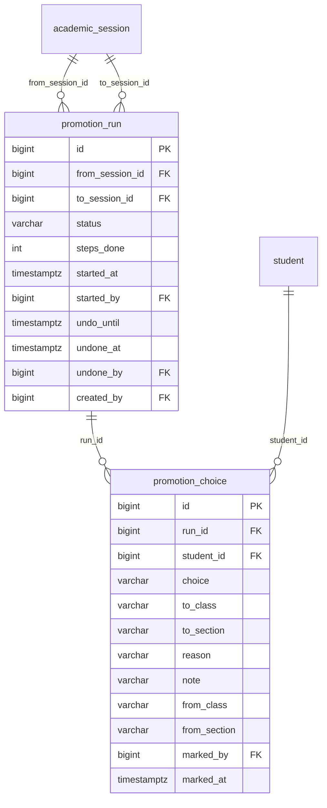

### `promotion_run`

One new school year (2026-27 → 2027-28), its status and its undo time.

| Column | Type | Can be empty | Values or limits | Note |
|---|---|---|---|---|
| `id` | bigint |  |  | identity |
| `from_session_id` | bigint |  |  | → `academic_session` |
| `to_session_id` | bigint |  |  | → `academic_session` |
| `status` | varchar(10) |  | `DRAFT`, `STARTED`, `DONE` · default `DRAFT` |  |
| `steps_done` | int |  | default `0` |  |
| `started_at` | timestamptz | yes |  |  |
| `started_by` | bigint | yes |  | → `app_user` |
| `undo_until` | timestamptz | yes |  | midnight of the start day |
| `undone_at` | timestamptz | yes |  | the last undo, if any |
| `undone_by` | bigint | yes |  | → `app_user` |
| `created_by` | bigint |  |  | → `app_user` |

Plus `created_at` and `updated_at`.

<details><summary>Constraints and indexes in the database</summary>

- `promotion_run_steps_done_check`: `CHECK (((steps_done >= 0) AND (steps_done <= 4)))`
- `promotion_run_two_sessions`: `CHECK ((from_session_id <> to_session_id))`
- `promotion_run_started`: `CHECK ((((status)::text = 'DRAFT'::text) OR ((started_at IS NOT NULL) AND (started_by IS NOT NULL))))`
- `promotion_run_to_session_id_key`: `UNIQUE (to_session_id)`
- `promotion_run_from_idx`: `CREATE INDEX promotion_run_from_idx ON promotion_run (from_session_id)`

</details>

**Used by:** `/promotion/*`

### `promotion_choice`

Only the children who do not simply move up one class (stay back, not coming back, other section).

| Column | Type | Can be empty | Values or limits | Note |
|---|---|---|---|---|
| `id` | bigint |  |  | identity |
| `run_id` | bigint |  |  | → `promotion_run` |
| `student_id` | bigint |  |  | → `student` |
| `choice` | varchar(20) |  | `MOVE_UP`, `STAY_BACK`, `NOT_COMING_BACK` |  |
| `to_class` | varchar(10) | yes | `Nursery`, `LKG`, `UKG`, `1`, `2`, `3`, `4`, `5`, `6`, `7`, `8`, `9`, `10`, `11`, `12` |  |
| `to_section` | varchar(1) | yes | `A`, `B`, `C` |  |
| `reason` | varchar(30) | yes | `MOVING_TOWN`, `OTHER_SCHOOL_HERE`, `FEES_TOO_HIGH`, `BUS_OR_DISTANCE`, `FINISHED_CLASS_12`, `OTHER` |  |
| `note` | varchar(200) | yes |  | 'Family moving to Hisar' |
| `from_class` | varchar(10) | yes |  |  |
| `from_section` | varchar(1) | yes |  |  |
| `marked_by` | bigint |  |  | → `app_user` |
| `marked_at` | timestamptz |  | default `now()` |  |

Plus `created_at` and `updated_at`.

**Rules**

- A child with no row moves up and keeps section, route and stop. Class 12 with no row becomes FINISHED.
- `from_class` and `from_section` are filled at start, so Undo can put every child back.

<details><summary>Constraints and indexes in the database</summary>

- `promotion_choice_not_coming`: `CHECK ((((choice)::text <> 'NOT_COMING_BACK'::text) OR ((reason IS NOT NULL) AND (to_class IS NULL))))`
- `promotion_choice_has_class`: `CHECK ((((choice)::text = 'NOT_COMING_BACK'::text) OR (to_class IS NOT NULL)))`
- `promotion_choice_once`: `UNIQUE (run_id, student_id)`
- `promotion_choice_student_idx`: `CREATE INDEX promotion_choice_student_idx ON promotion_choice (student_id)`

</details>

**Used by:** `/promotion/not-coming-back`, `/promotion/classes/*`, `POST /promotion/start`


---

## Marks (later)

Flyway file: `later/marks.sql` · **Later**, not in the first release

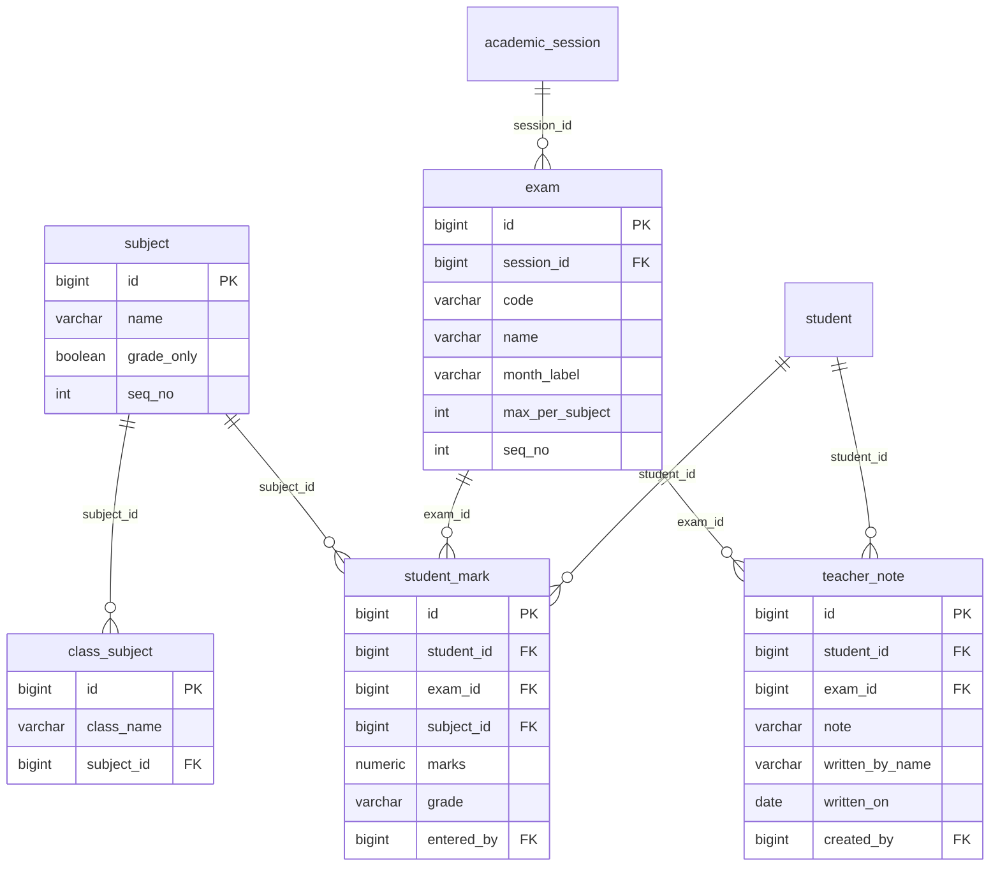

### `exam`

The 4 exams of a session (later).

| Column | Type | Can be empty | Values or limits | Note |
|---|---|---|---|---|
| `id` | bigint |  |  | identity |
| `session_id` | bigint |  |  | → `academic_session` |
| `code` | varchar(10) |  | `UT1`, `HY`, `UT2`, `FINAL` |  |
| `name` | varchar(40) |  |  | 'Half-yearly' |
| `month_label` | varchar(20) |  |  | 'September' |
| `max_per_subject` | int |  | `> 0` |  |
| `seq_no` | int |  |  |  |

Plus `created_at` and `updated_at`.

<details><summary>Constraints and indexes in the database</summary>

- `exam_once`: `UNIQUE (session_id, code)`

</details>

**Used by:** `GET /students/{id}/marks`

### `subject`

A subject, and whether it gets a grade instead of marks (later).

| Column | Type | Can be empty | Values or limits | Note |
|---|---|---|---|---|
| `id` | bigint |  |  | identity |
| `name` | varchar(40) |  |  | 'Maths' |
| `grade_only` | boolean |  | default `false` | Drawing: a grade, not marks; not in the total |
| `seq_no` | int |  |  |  |

Plus `created_at` and `updated_at`.

<details><summary>Constraints and indexes in the database</summary>

- `subject_name_key`: `UNIQUE (name)`

</details>

**Used by:** `GET /students/{id}/marks`

### `class_subject`

Which subjects a class has (later).

| Column | Type | Can be empty | Values or limits | Note |
|---|---|---|---|---|
| `id` | bigint |  |  | identity |
| `class_name` | varchar(10) |  | `Nursery`, `LKG`, `UKG`, `1`, `2`, `3`, `4`, `5`, `6`, `7`, `8`, `9`, `10`, `11`, `12` |  |
| `subject_id` | bigint |  |  | → `subject` |

Plus `created_at` and `updated_at`.

<details><summary>Constraints and indexes in the database</summary>

- `class_subject_once`: `UNIQUE (class_name, subject_id)`
- `class_subject_subject_idx`: `CREATE INDEX class_subject_subject_idx ON class_subject (subject_id)`

</details>

**Used by:** `PUT /students/{id}/marks/{examCode}`

### `student_mark`

One mark or grade of one child, one exam, one subject (later).

| Column | Type | Can be empty | Values or limits | Note |
|---|---|---|---|---|
| `id` | bigint |  |  | identity |
| `student_id` | bigint |  |  | → `student` |
| `exam_id` | bigint |  |  | → `exam` |
| `subject_id` | bigint |  |  | → `subject` |
| `marks` | numeric(5,1) | yes | `>= 0` | 68.0 |
| `grade` | varchar(3) | yes |  | 'A' for a grade-only subject |
| `entered_by` | bigint |  |  | → `app_user` |

Plus `created_at` and `updated_at`.

<details><summary>Constraints and indexes in the database</summary>

- `student_mark_one_value`: `CHECK (((marks IS NULL) <> (grade IS NULL)))`
- `student_mark_once`: `UNIQUE (student_id, exam_id, subject_id)`
- `student_mark_exam_idx`: `CREATE INDEX student_mark_exam_idx ON student_mark (exam_id)`
- `student_mark_subject_idx`: `CREATE INDEX student_mark_subject_idx ON student_mark (subject_id)`

</details>

**Used by:** `/students/{id}/marks/*`

### `teacher_note`

The class teacher's note for one child after one exam (later).

| Column | Type | Can be empty | Values or limits | Note |
|---|---|---|---|---|
| `id` | bigint |  |  | identity |
| `student_id` | bigint |  |  | → `student` |
| `exam_id` | bigint |  |  | → `exam` |
| `note` | varchar(500) |  |  |  |
| `written_by_name` | varchar(120) |  |  | 'Ms Rekha' (teachers do not log in yet) |
| `written_on` | date |  |  |  |
| `created_by` | bigint |  |  | → `app_user` |

Plus `created_at` and `updated_at`.

<details><summary>Constraints and indexes in the database</summary>

- `teacher_note_once`: `UNIQUE (student_id, exam_id)`
- `teacher_note_exam_idx`: `CREATE INDEX teacher_note_exam_idx ON teacher_note (exam_id)`

</details>

**Used by:** `GET /students/{id}/marks`


---

## The queries used everywhere

Write each one once, in a service, and use it from every screen. All of them are tested in `db-checks/checks.sql`
with the sample data. `:day` is the school day in Asia/Kolkata, made from the injected `Clock`, never `now()` in SQL.

### 1. Children on route R on day D

Used by the manifest, Bus status, Routes and load.

```sql
select te.student_id, te.stop_id
from transport_enrolment te
join student s on s.id = te.student_id
where te.route_id = :routeId
  and te.uses_bus
  and te.from_date <= :day and (te.to_date is null or te.to_date >= :day)
  and s.status = 'ACTIVE' and s.joined_on <= :day;
```

Example: Route 4 on 7 Oct 2026 → 19 children: Sadhanwas 5, Jakhal 7, Kanheri 4, Tohana town 3.

### 2. People on vehicle V on day D

The temporary row (a replacement) wins over the normal row.

```sql
select distinct on (duty) duty, staff_id, temporary
from vehicle_assignment
where vehicle_id = :vehicleId
  and from_date <= :day and (to_date is null or to_date >= :day)
order by duty, temporary desc, from_date desc;
```

Example: Van 4 on 14 Oct → driver Surender (temporary, Jagdish is on leave). On 17 Oct → Jagdish again. Nobody changed Jagdish's row.

### 3. The attendant's route today

Protects every trip URL: an attendant may only see and tap their own route of today.

```sql
select r.id
from app_user u
join lateral (
    select distinct on (va.vehicle_id) va.vehicle_id, va.staff_id
    from vehicle_assignment va
    where va.duty = 'ATTENDANT'
      and va.from_date <= :day and (va.to_date is null or va.to_date >= :day)
    order by va.vehicle_id, va.temporary desc, va.from_date desc
) today on today.staff_id = u.staff_id
join route r on r.vehicle_id = today.vehicle_id and r.active
where u.id = :userId;
```

No row → `noTripReason: NOT_ASSIGNED`. Example: Balwan (user 14) on 7 Oct → Route 4.

### 4. The family of a child

```sql
select guardian_id as family_id from student_guardian where student_id = :studentId and is_primary;
-- all children of a family:
select sg.student_id from student_guardian sg join student s on s.id = sg.student_id
where sg.guardian_id = :familyId and sg.is_primary and s.status = 'ACTIVE';
```

Example: Aryan (57) and Siya (12) both have Rajesh Punia (210) as primary → family 210.

### 5. The status of a month

`v_fee_month` gives, for each child and month: what is due, what is paid, the balance, the due date and the grace date.
The Java service picks the status with today's date:

| If | Status | Example on 7 Oct (grace until the 10th) |
|---|---|---|
| `balance = 0` | PAID | Aryan, August |
| `paid_school + paid_bus > 0` | PART_PAID | |
| today > `grace_date` | LATE (late fee if paid now) | Aryan, September |
| today >= `due_date` | DUE | Aryan, October |
| otherwise | NOT_DUE | Aryan, November |
| no `fee_due` row | NO_FEE | Riya, before she joined |

Late fee of a LATE month, when `late_fee_kind` is PER_MONTH: `late_fee_per_month` (if no LATE line is paid for it yet).
When PER_DAY: `(today − grace_date) × late_fee_per_day`, at most `late_fee_max_per_month`.

The fee status of a child for Analytics (ON_TIME / DELAYED / DEFAULTED): find the oldest month with a balance.
Days late = today − its due date. Up to the grace days → ON_TIME; up to `fees.defaulted_after_days` (60) → DELAYED; more → DEFAULTED.

### 6. What each family owes today ("Families with dues", "Pending now")

```sql
with fam as (
    select sg.guardian_id as family_id, sg.student_id
    from student_guardian sg join student s on s.id = sg.student_id
    where sg.is_primary and s.status = 'ACTIVE'
), open_month as (
    select f.family_id, v.*, sfs.late_fee_kind, sfs.late_fee_per_month
    from fam f
    join v_fee_month v on v.student_id = f.student_id
    join session_fee_setting sfs on sfs.session_id = v.session_id
    where v.session_id = :sessionId and v.balance > 0
)
select family_id,
       sum(balance) filter (where due_date <= :day)                                as due_now,
       sum(case when late_fee_kind = 'PER_MONTH' and :day > grace_date and paid_late = 0
                then late_fee_per_month else 0 end)                                 as late_fee,
       count(distinct month) filter (where :day > grace_date)                      as late_months
from open_month
group by family_id;
```

Example on 7 Oct: Punia family → due 15,200 + late fee 200 = **15,400**, 1 late month. Chauhan → 21,100, 4 late months.
"Families with dues" shows the families with `late_months > 0`. "From last year" is the same query with the old session.

### 7. Save a payment (POST /fees/payments), in one transaction

1. If `client_request_id` is already in `receipt`: return that receipt and stop (a double click).
2. Lock the `fee_due` rows of the picked months: `select ... for update`. If a month is already paid → 409 MONTH_ALREADY_PAID.
3. Count the late fee (normal), take `lateFeeOverride` if sent (check the role is in `late_fee_change_roles`).
4. `number_counter` 'RECEIPT-2026': `select ... for update`, +1 → `R-2026-1189`.
5. Insert `receipt`.
6. Insert the lines in `fee_payment`: late fee first, then month by month (school, then bus), child by child, until the money ends.
   If the money ends inside a month, that month is PART_PAID.
7. If family credit is used: a minus row in `family_credit_entry`, and `credit_used` on the receipt.
8. If "send on WhatsApp": a QUEUED row in `message_outbox` with `receipt_id`.
9. One `audit_log` row (and one more for a changed late fee, with the reason).

Check: `receipt.amount + receipt.credit_used = sum(fee_payment.amount)` for every receipt.

### 8. Cancel a receipt (POST /receipts/{no}/cancel)

1. `update receipt set status = 'CANCELLED', cancelled_at, cancelled_by, cancel_reason, cancel_note`.
2. For every line of the receipt: insert a copy with `amount = −amount` and `reversal_of_id = line.id`.
   (`reversal_of_id` is unique, so a line can never be reversed twice.)
3. The months are unpaid again on their own, because `v_fee_month` sums the lines.
4. If asked: a RECEIPT_CANCELLED message in `message_outbox`.

### 9. A bus change (PUT /students/{id}/transport)

1. Find the row that covers `fromDate`. Set its `to_date = fromDate − 1 day`.
   If that row starts on `fromDate` itself and has no taps or payments, update it instead.
2. Insert the new row from `fromDate` (with or without a bus). Its id is the `changeId`.
3. Rewrite `fee_due.bus_amount` of the **unpaid** months from that month on.
4. Undo (DELETE .../changes/{changeId}): delete the new row, set the row before it back to its old `to_date`, rewrite the unpaid months again.

### 10. Start the new school year (POST /promotion/start), in one transaction

1. For each active child who joined on or before the last day of the old session:
   - a `promotion_choice` row decides; no row = move up one class, same section. Class 12 with no row → FINISHED.
   - save `from_class` and `from_section` in the choice (make a MOVE_UP row for those who had none).
2. NOT_COMING_BACK children: `status = 'LEFT'`, `left_on` = the last day of the old session, their bus rows end.
3. Make `fee_plan` and `fee_due` rows for the new session from its `class_fee` and `session_fee_setting`.
4. `promotion_run.status = 'STARTED'`, `undo_until` = midnight.
5. Undo: put class and section back from the choices, delete the new session's `fee_plan` and `fee_due` rows (409 if a payment is already saved in the new session), status back to DRAFT.


---

## Java entities: the tricky types

`spring.jpa.hibernate.ddl-auto=validate` checks every entity against these tables. These types need a line more than usual:

| Column | Java field |
|---|---|
| `bigint generated always as identity` | `@Id @GeneratedValue(strategy = GenerationType.IDENTITY) Long id` |
| `numeric(12,2)` | `@Column(precision = 12, scale = 2) BigDecimal amount` |
| `timestamptz` | `OffsetDateTime` (or `Instant`) |
| `date` | `LocalDate` (a month column too: `2026-10-01`) |
| `time` | `LocalTime` |
| `varchar` with a check list | `@Enumerated(EnumType.STRING) @Column(length = 20) Role role` |
| `int[]` (`session_fee_setting.bus_months`) | `@JdbcTypeCode(SqlTypes.ARRAY) @Column(columnDefinition = "int[]") Integer[] busMonths` |
| `varchar(30)[]` (`late_fee_change_roles`) | `@JdbcTypeCode(SqlTypes.ARRAY) @Column(columnDefinition = "varchar(30)[]") String[] lateFeeChangeRoles` |
| `jsonb` (`admission_draft.form`, `audit_log.details`) | `@JdbcTypeCode(SqlTypes.JSON) Map<String, Object> form` |
| `fee_payment`, `family_credit_entry` | add `@org.hibernate.annotations.Immutable` to the entity: Hibernate never sends an update |
| `v_fee_month` (a view) | do not make it an entity (validate would look for a table). Read it with `JdbcClient` or a native query into a record |

Relations to other features are ids, not objects: `Long routeId`, not `@ManyToOne Route route` (see `docs/02-architecture.md`).

## Sample data and checks

| File | What it is |
|---|---|
| `src/main/resources/db/dev/sample-data.sql` | The people and numbers of the designs: Punia family, Route 4 with 19 children, the receipts of 7 Oct, Kavya Goyal's admission, 290 students in all. It deletes the data first, so it runs only with `-v dev=1`. |
| `db-checks/checks.sql` | 62 checks: the numbers of the designs (Punia owes 15,400; 46,000 collected by 11:30; Route 4 has 19 children) and 28 kinds of bad data the database must refuse. Nothing is saved. |
| `db-checks/run-checks.sh` | Makes a fresh database `school_check`, runs every migration, the sample data and the checks. |

Run it against the PostgreSQL of `compose.yaml`:

```bash
PGHOST=localhost PGPORT=5432 PGUSER=school PGPASSWORD=school ./db-checks/run-checks.sh
```

The last line must be `All checks passed. Nothing was saved.`

## What changed from the old data model

| Old | New | Why |
|---|---|---|
| `academic_session` in V7 | in V1 | Admissions (V3) and enquiries (V6) need it |
| `admission_counter`, `receipt_counter` | one `number_counter` (admission, receipt, TC, refund) | One way to make every number |
| `enquiry.session_name` text | `enquiry.session_id` → `academic_session` | |
| `transport_enrolment.bus_fee` for a period | `bus_fee_per_month`, `uses_bus`, `reason`, `note`; "no bus" is a period too | Bus fee a month, undo of a change, history |
| `class_fee.school_fee` for the year | `class_fee.per_month` | Fees are month by month |
| `fee_plan` one row per year, year amounts | rows from a month on, month amounts, `follows_class_fee` | "A change starts from the next unpaid month" |
| `fee_due` per installment date | one row per child per month (school, discount, bus) | The 12 month boxes of Collect fees |
| `fee_payment` per head, with `receipt_no` text | `receipt` table + lines per child, month and head (SCHOOL / BUS / LATE) | One receipt for the family, cancel, late fee |
| correction rows by hand | cancel = reversal lines with `reversal_of_id` | Cancel a receipt |
| `app_setting` `transport.bus_fee_per_year`, `fees.grace_days` | in `session_fee_setting` | They can change per year |
| `guardian.phone` always filled | can be empty (name only) | "Mother, no number saved" |
| `message_template` code with `_M` / `_F` | `code` + `gender`, plus `approved_body` and `approval` | Boy and girl texts, DLT approval |
| `message_outbox` status QUEUED/SENT/FAILED | + DELIVERED, CANCELLED, `problem`, `receipt_id`, `fallback_of_id` | Messages page, receipts on WhatsApp |
| — | new: `holiday`, `bus_sms_rule`, `upload`, `student_document`, `student_document_note`, `admission_draft`, `transfer_certificate`, `enquiry_stage`, `session_fee_setting`, `receipt`, `family_credit_entry`, `promotion_run`, `promotion_choice` | The new screens |
