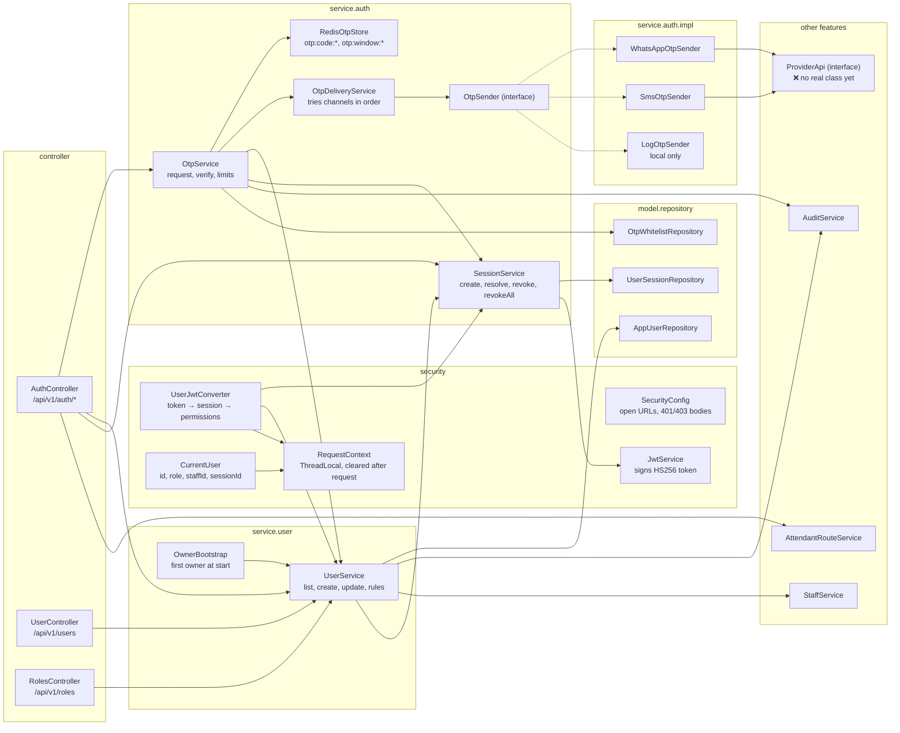
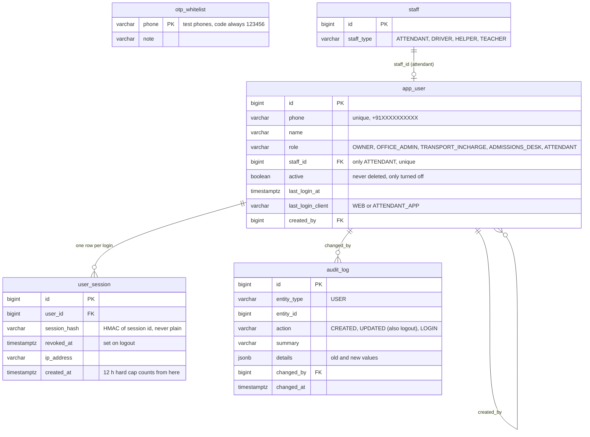
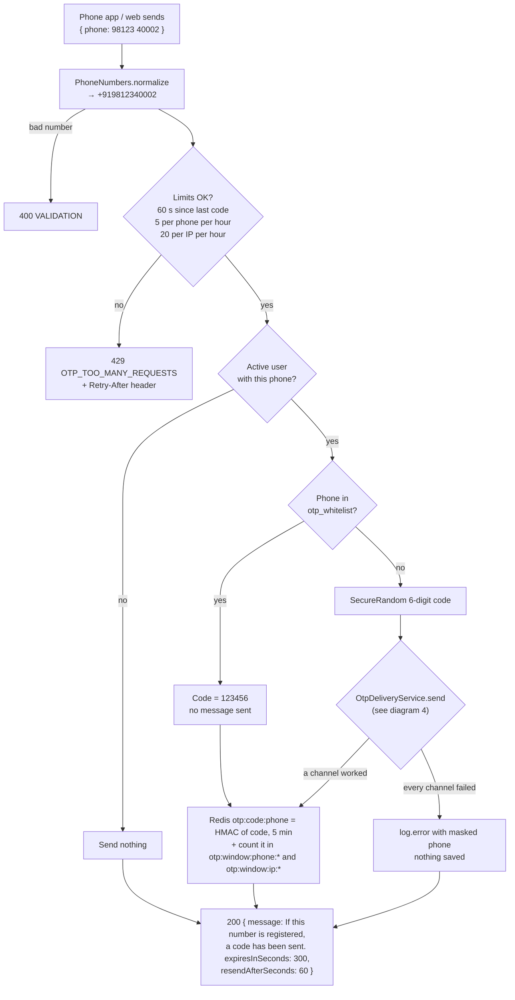
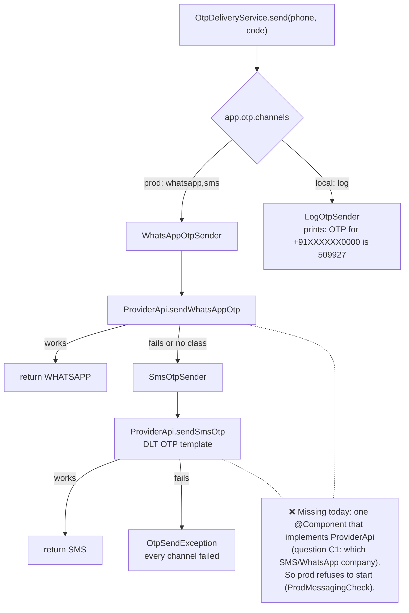
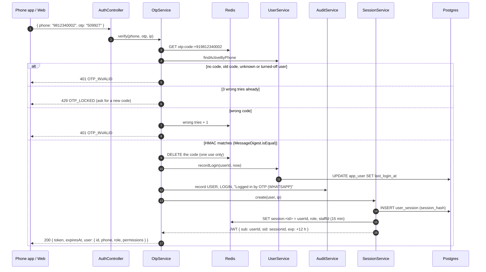
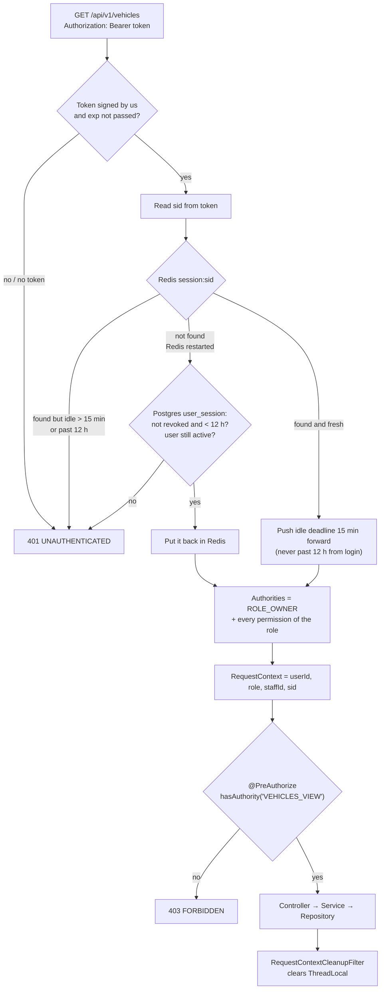
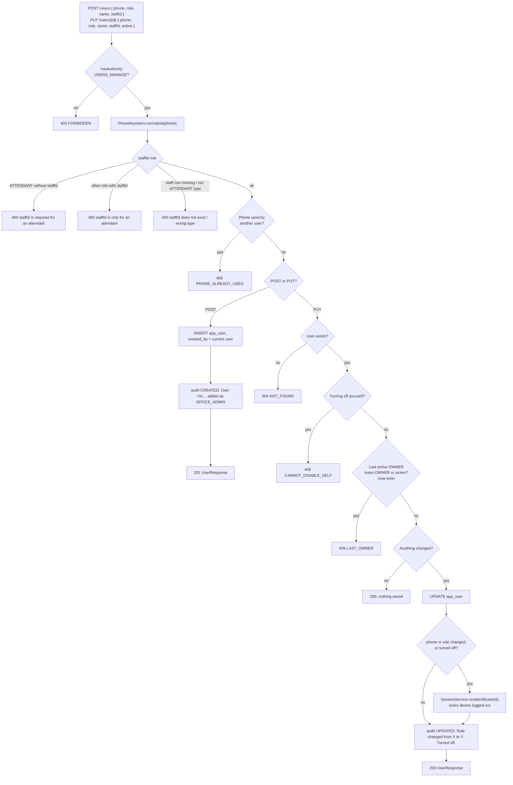
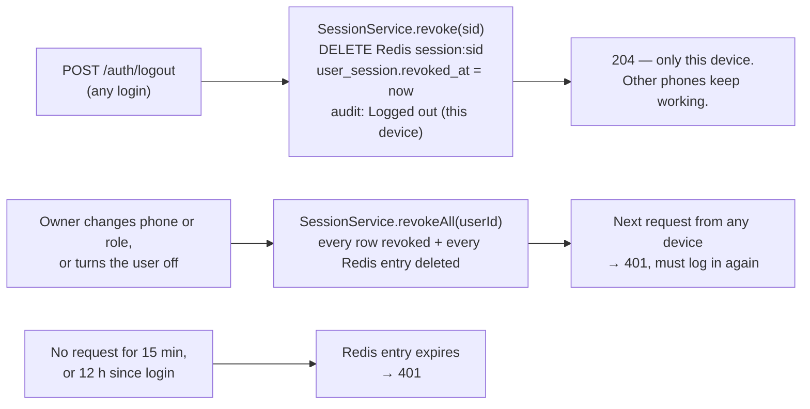
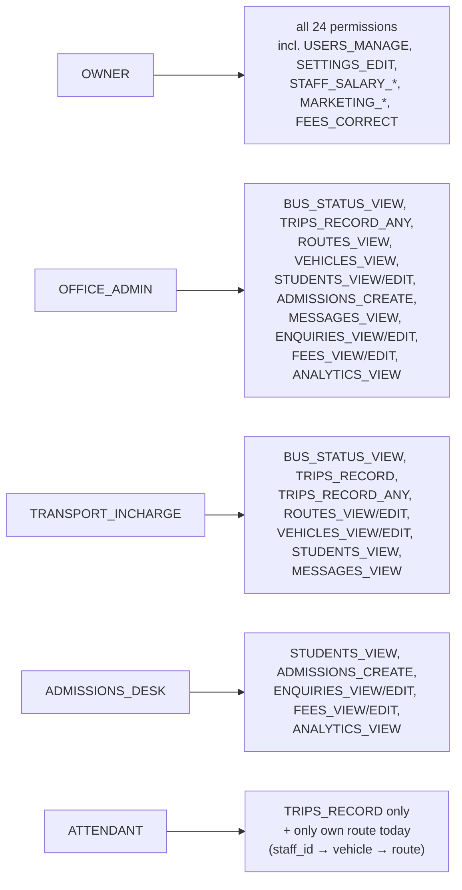

# User module — flow diagrams

Everything about users and login, in pictures. Open this file in GitHub or IntelliJ (Markdown preview) to see
the diagrams drawn.

Code lives in `com.muhjain.school`. Rules come from `docs/04-login-otp-jwt.md`, `docs/05-roles-permissions.md`
and `docs/phases/phase-1-login-users.md`.

| # | Diagram | Answers |
|---|---|---|
| 1 | Files and layers | Which class calls which |
| 2 | Tables | What is stored where (Postgres and Redis) |
| 3 | Ask for a code | `POST /auth/otp/request` |
| 4 | Send the code | WhatsApp → SMS → log, and what is still missing |
| 5 | Check the code, log in | `POST /auth/otp/verify` |
| 6 | Every request after login | How the token becomes "user 2, OWNER, these permissions" |
| 7 | Add or change a user | `POST /users`, `PUT /users/{id}` and their rules |
| 8 | Log out and end sessions | One device, or every device |
| 9 | Roles and permissions | Who may do what |

---

## 1. Files and layers

Arrows mean "calls". A controller never calls a repository. Other features call `UserService`, never
`AppUserRepository`.

---

## 2. Tables

Postgres keeps what must last. Redis keeps short-lived things: OTP codes and the fast copy of each session.

Redis keys (nothing here needs to survive a restart):

| Key | Holds | Lives |
|---|---|---|
| `otp:code:<phone>` | HMAC of the code, channel, wrong tries | 5 minutes |
| `otp:window:phone:<phone>`, `otp:window:ip:<ip>` | times of recent codes, for the limits | 1 hour |
| `session:<id>` | user id, role, staffId, idle deadline | 15 minutes idle, slides on every request |
| `user_sessions:<userId>` | the set of that user's session ids | used by "log out everywhere" |

---

## 3. Ask for a code — `POST /api/v1/auth/otp/request`

The answer is the same for a known and an unknown phone, so nobody can find out who is a user.

---

## 4. Send the code — WhatsApp, then SMS, then log

`app.otp.channels` decides the order. The first channel that works wins.

---

## 5. Check the code and log in — `POST /api/v1/auth/otp/verify`

Wrong code, old code, no code, unknown user, turned-off user: all give the same `401 OTP_INVALID`.

---

## 6. Every request after login

The role comes from the session, not from the token. So a role change works at once.

---

## 7. Add or change a user — `POST /users`, `PUT /users/{id}`

Only `USERS_MANAGE` (the owner). Every change is saved in `audit_log`.

First owner: when `app_user` is empty at start, `OwnerBootstrap` creates an OWNER with `APP_OWNER_PHONE`
(local default `9999900000`).

---

## 8. Log out and end sessions

---

## 9. Roles and permissions

Roles are fixed in `model/enums/Role.java`, not in a table. Controllers check **permissions**, never roles.

Test logins in `local` (code always `123456`): `9999900001` OWNER, `9999900002` OFFICE_ADMIN,
`9999900003` TRANSPORT_INCHARGE, `9999900004` ATTENDANT.
